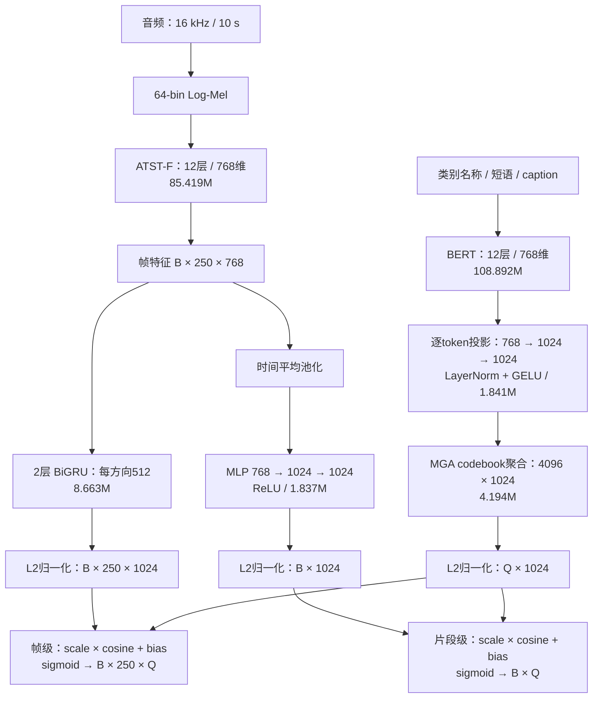

# COSED 论文重建

rabbit02 的工作目录为 `/work/zhanghc/Myllm/COSED`。这是按 [COSED v1](https://arxiv.org/html/2609.30083v1) 独立实现的单种子实验。用 `finelapt` Python 环境运行。两个编码器端到端训练，从公开的弱标签 ATST-F 和 MGA-CLAP 文本分支权重初始化。

## 训练与测评

```bash
cd /work/zhanghc/Myllm/COSED
nohup bash run.sh > log/launcher.log 2>&1 < /dev/null &
cat runs/seed31415926_grufp32_scale10/status.json
tail -f log/seed31415926_grufp32_scale10.log
```

run.sh 使用锁防止重复启动。如果上次进程已退出，可以用同一命令从last.pt恢复。首步、每50步、每轮验证前后原子覆盖保存last.pt，包含模型、EMA、优化器、轮内位置及各卡随机状态；恢复要求batch、micro、卡数、种子及每轮步数不变，跳过已保存的批次。epoch字段表示已完成验证的轮数，batch_in_epoch表示当前轮已完成的批次数；训练状态中的epoch则为正在执行的轮号。中断可能损失最近一次保存后的步骤；若没有last.pt，则从初始化重新开始。

每轮在可匹配的AS-S eval上算EMA PSDS1，保存最优best.pt。最多40轮，连续10次验证未改善即停止，然后自动用最佳EMA权重跑六套benchmark，另存DESED Validation。summary.json在相应运行目录的benchmark_权重哈希/。短程预检位于runs/pilot_1024/，其小验证集成绩仅检查管线。日志PARAMETER_UPDATES记录各模块抽样参数在一次实际更新前后的变化，以及非零Adam一阶矩的参数组数；它用于检查更新链路，不能替代效果评估。

## 实现口径

2026-11-05 精度核查：归档实验 `runs/seed31415926` 的 BiGRU 在 3090 上实际运行于 FP16。正式首批重放时 16 组参数的梯度全为零。现有入口将 BiGRU 与其输出归一化置于 FP32，在首次优化前检查输入权重收到非零梯度。新运行名为 `seed31415926_grufp32`，独立于旧 checkpoint。只做过零学习率单批验证。核查数字见实验总结。

- 单种子 31415926，四张 3090，总 batch 1024。每次更新先确定整个逻辑批次的查询和各损失分母，每卡分块处理 8 条音频。对文本嵌入累计梯度后回传文本塔，对所有卡的参数梯度求和，再做一次梯度裁剪与 AdamW 更新。
- 五源数据直接复用既有 JSONL，倍率 1×AS-S、1×FineLAP-100k、2×AudioCaps、5×TACOS、4×Clotho。AS-S 监督全部 447 个类。FineLAP-100k 和 TACOS 使用有时间的短语，AudioCaps 与 Clotho 各自做片段级描述监督。相同文本在同一来源内去重。
- 使用 16 kHz、10 秒输入和 250 帧。跨来源条目排除，类别块按监督总数归一化。描述正负项分别按标签总量归一化。focal 指数均为 1，帧级类别权重 0.9，描述正例块权重 0.05，整段损失权重 0.1。两路可学习乘法scale初始为10，偏置为−10；历史实验scale为0.1。
- 使用论文四组学习率、AdamW、权重衰减 0.001、裁剪 1.0、300 步 warmup、cosine 和 EMA 0.999。验证及 benchmark 使用 9 帧中值滤波。AS-S PSDS1 采用 [PretrainedSED](https://github.com/fschmid56/PretrainedSED) 的训练/评估交集和参数，同类相交区间合并，实际验证数量和文件指纹在 log/provenance.json。
- 六套 benchmark 复用已冻结的清单和计分器，长片 10 秒窗、5 秒 hop，TACOS 保存两种口径。MAESTRO 为 development。模型选择仅看 AS-S。

## 本地重建的差异

- 公开 AS-S 训练类表为 447 项。祖先扩充依据原始 AudioSet ontology，应用论文示例中 Alarm、Bell 与 Doorbell 的修改。其余未取得的边调整没有猜补。
- TACOS 只使用 development。本地根据 metadata 的 subclass=Speech 排除 453 条，实际保留 9905 条。论文排除了 1401 条，名单未取得。未得到作者的 Llama-4 TACOS 改写，使用原描述。12 个类别提示模板为本地构造。
- 波形和频谱 mixup 限定同来源并混合对应软标签。频率变形、频带增益、Freq-MixStyle 的强度、概率为本地设置，见 train.py。短片首声道、补零、帧边界离散化和 512/方向的 BiGRU 隐层是重建选择。
- 文本塔采用 MGA-CLAP 原生的 BERT、word projection 与 codebook 聚合。三个固定查询与原生 FP32 结果的最大误差记在 log/text_check.json。报告的 210,845,956 个参数只属于本实现。
- 使用 4×RTX 3090、BF16 autocast、分块及文本激活重计算。论文使用 8×H100，并报告三个种子均值。当前先做一个种子。当前缺少的 AS-S 音频以及本地 benchmark 与论文的协议差异继续保留。


## 作者澄清（2026-11-09）

用户收到作者邮件：实际乘法scale初始化为10，非论文文字对应的0.1；保留并微调MGA-CLAP codebook。现已修改model.py默认初始化为10，公式仍为scale*cos+bias，不取倒数或指数。偏置沿用−10。codebook严格加载MGA公开权重，作为文本塔参数参与优化和EMA，学习率为1.54e-5（随原调度变化）。

train.py支持`--initial-scale`及`--initial-bias`，在config.json和last.pt中记录初始化。恢复时检查配置是否一致；旧checkpoint未记录配置时按历史0.1/−10识别，禁止默认新配置误恢复旧运行。run.sh指向独立的`seed31415926_grufp32_scale10`目录；仅更新入口，尚未启动。既有audit_gradients.py、audit_representations.py显式使用历史scale=0.1，旧结果仍可复算。未改数据、损失、增强或正式Mel预处理。细节见analysis/experiment_summary.md。

## 当前网络结构与参数量（2026-11-09实测）

以下为rabbit02当前实际重建版本，非作者官方参数统计。所有参数requires_grad=True；ATST的mask_embed在当前无掩码前向中不获得任务梯度。EMA是同结构的移动平均副本，不计入单模型参数量。B表示音频batch，Q表示查询数量，T=250，D=1024。



| 模块 | 参数量 | 百万参数 |
|---|---:|---:|
| ATST-F音频编码器 | 85,419,264 | 85.419M |
| BERT文本编码器（无pooler） | 108,891,648 | 108.892M |
| 文本token投影 | 1,840,640 | 1.841M |
| MGA codebook | 4,194,304 | 4.194M |
| 两层BiGRU | 8,663,040 | 8.663M |
| 片段级MLP | 1,837,056 | 1.837M |
| 两路scale/bias | 4 | — |
| 合计 | 210,845,956 | 210.846M |

Codebook读取过程：投影后的有效token与codebook计算匹配，经token维最大聚合和sparsemax得到4096个权重，再加权组合codebook向量，输出1024维文本查询。当前具体聚合实现仍是本地重建，作者已确认保留并微调codebook。

帧级与片段级分支共享ATST与文本查询；片段级分支直接池化ATST输出，不经过BiGRU。帧级负责强时间监督，片段级用于AudioCaps/Clotho弱描述监督。训练focal直接接收logits，图中sigmoid表示概率输出。两路分别有独立可学习scale和bias，初始化10/−10。BiGRU及帧特征归一化使用FP32。网络含双向模块，当前不是因果流式模型。

单份参数按FP32约843.4 MB（804.3 MiB），BF16约421.7 MB（402.2 MiB）；这只是权重存储量，不含EMA、梯度、Adam状态、激活或运行缓存。本次训练使用autocast，主参数仍为FP32，不能按BF16权重文件大小估算训练显存。
