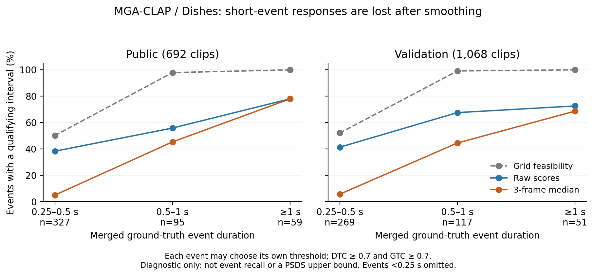
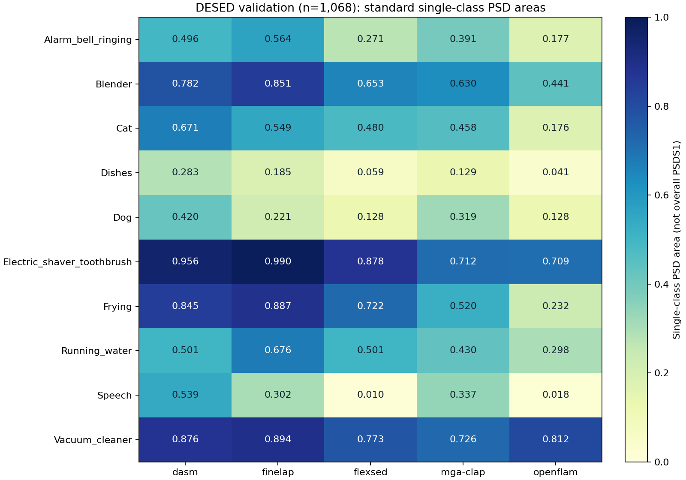

# DESED 科研分析

更新：2026-10-19。主分析使用 **692 条 Public Test 音频**；文末保留 Validation 辅助分析，两者不混合。沿用已保存的预测和标准评分，本轮没有重新训练或调整主评测阈值。

## 独立复核：模型瓶颈与科研问题（2026-10-19）

本轮在 rabbit05 直接读取两个 split、五模型的 **8,800 个已保存预测文件**，聚焦 Speech、Dishes，并以 Dog、Vacuum_cleaner 为参照。固定模型输出，重新计算平滑前、当前平滑后、真值辅助排除阴性音频三种条件下的标准逐类 PSD 面积。40 个当前逐类面积均与既有官方评分文件一致，误差小于 1e-10；没有改写主评分、原始预测或权重。

**当前最有证据的研究问题是：如何保留短事件的时间证据，同时抑制背景并让跨音频分数可用。不同模型、不同类别受限于不同环节，不能用一个总体排名推导统一原因。** 下列反事实诊断已经完成；后面的既有分析保留为初步探索记录。

### 1. MGA-CLAP 的短餐具事件受到粗时间网格和后处理的双重限制

当前 MGA-CLAP 输出步长为 0.3125 秒，三帧中值窗口的名义跨度为 0.9375 秒；DESED Public Dishes 的事件中位时长仅 0.327 秒。这里的步长是输出网格间隔，不等于编码器感受野。

对每个合并后的 GT 事件，穷举分数能产生的连续预测区间，检查是否存在某个阈值，使单个预测区间同时覆盖至少 70% 的 GT，且至少 70% 的预测时长落在该 GT 内。此处允许不同事件选不同阈值，并忽略其他误报，**不是事件召回率，也不是正式 PSDS 上界**。官方匹配还能累计多个事件间的交集，不能把该诊断直接换算成官方漏检数。

| MGA-CLAP / Dishes，0.25–0.5 秒事件 | Public | Validation |
|---|---:|---:|
| 合并事件数 / 源录音组数 | 327 / 113 | 269 / 112 |
| 仅受网格限制，存在合格区间 | 50.2% | 52.0% |
| 原始分数存在合格阈值区间 | 38.2% | 41.3% |
| 当前平滑后存在合格阈值区间 | 4.9% | 5.6% |
| 平滑后减平滑前 | −33.3 个百分点 | −35.7 个百分点 |
| 配对源录音 bootstrap 的 95% 区间 | [−38.6, −28.2] 个百分点 | [−40.4, −31.1] 个百分点 |

采用事件加权统计、按源录音整体抽样，3,000 次，随机种子 20261019；区间为探索性百分位区间，未做多重比较校正。源录音组由片段 ID 去掉末尾起止时间得到。只保留与相邻同类事件间隔至少 1 秒的短事件，下降仍存在：Public 103 个事件从 43.7% 降到 5.8%；Validation 80 个事件从 43.8% 降到 11.3%。因此，现象并不只来自密集标注之间的合并。



标准逐类面积也确认 MGA-CLAP 的 Dishes 受损：Public **0.1555 → 0.0974**，Validation **0.1789 → 0.1294**。但同一平滑处理使 Public Speech **0.2897 → 0.3968**。因此不能统一取消平滑；真正的取舍是短峰保留与背景抑制。

FineLAP 说明这不是简单的“平滑越少越好”：其 Public Dishes 面积从 **0.0654 提高到 0.1928**，虽然短事件的上述可匹配比例略有下降。单事件可达性不计其他误报，不能替代完整标准指标。DASM 的 Dishes 当前面积为 0.3291，但仍有提升空间；不能因为相对排名第一就视为已解决短事件定位。

### 2. Dishes 不能主要靠“判断整段有没有目标”解决；Speech 需要分模型处理

诊断干预：使用 GT 将完全不含该类的音频分数设为极低值，保留所有音频和评测时长，阳性音频分数保持不变。它只消除完全阴性音频的响应，不消除阳性音频中的背景误报。**这是不可部署的真值辅助实验，不是新模型成绩，也不能用于相加分解误差贡献。**

| Public 单类别 PSD 面积 | 当前 | 排除阴性音频响应后 |
|---|---:|---:|
| DASM / Dishes | 0.3291 | 0.3307 |
| FineLAP / Dishes | 0.1928 | 0.1978 |
| MGA-CLAP / Dishes | 0.0974 | 0.0996 |
| FineLAP / Speech | 0.3817 | 0.5846 |
| FlexSED / Speech | 0.0063 | 0.0345 |
| OpenFLAM / Speech | 0.0141 | 0.0298 |

- **Dishes：** DASM、FineLAP、MGA-CLAP 在完全消除阴性音频响应后仍改善很小。仅加强片段存在性分类不足以解决；后续必须定位阳性音频内的背景响应、时间覆盖、碎片化及跨阳性音频分数差异。
- **FineLAP Speech：** 阴性音频抑制有较大潜力；Validation 也从 0.3022 提高到 0.4632。值得测试真正可部署的存在性分支或条件校准，但不能承诺达到真值辅助结果。
- **FlexSED Speech：** 时间分辨率不是足够解释。Public 的 913 个 Speech 事件中，74.9% 在平滑后存在某个合格阈值区间，但完整标准面积只有 0.0063；即使去掉完全阴性音频响应也只有 0.0345。应进一步检查阳性音频中的误触发、跨音频分数排序和事件结构。
- **OpenFLAM Speech：** 同类诊断比例只有 37.2%，且去掉阴性音频后仍低，提示局部目标区分也有问题。308 条符合峰位置诊断条件的阳性音频中，108 条的最大响应严格落在完全不与 GT 重叠的帧上，另有 35 条并列。这不是全数据的误报率，也不能未经听辨便断言标签正确、响应一定错误。

上述阈值诊断不能用于评价统一部署阈值；不同模型原始分数也不是同一个概率尺度。对于遍历全部阈值的 PSD 曲线，**对一个类别的所有分数做相同的严格单调变换不会改变排序和可达到的预测集合**，因此仅做全局温度缩放不能解决这里的 PSDS 问题。有效改进需要改变跨音频/时间的相对排序或事件结构。

### 3. 当前研究设计中尚未解决的问题

1. **架构因果归因不足。** 现有模型同时改变了编码器、训练语料、监督、文本查询、输出步长和后处理。DASM 优于某模型不能单独证明 BiGRU 优于 Transformer，也不能证明强监督这一因素贡献了全部差异。结构结论应在同编码器、输入特征、数据和训练预算下比较。
2. **后处理尺度没有自然可比性。** 当前名义中值窗口跨度为 DASM 0.320 秒、FineLAP 0.46875 秒、FlexSED 0.360 秒、MGA-CLAP/OpenFLAM 0.9375 秒。保留各方法的复现配置作为基线，再做按秒统一窗口的受控对照；不能把“都是三帧”当成相同处理强度。
3. **跨数据集的任务粒度不同。** DESED Dishes 中位时长 0.327 秒，RealDESED cutlery_dishes 为 1.600 秒；DESED Dog 为 0.388 秒，UrbanSED dog_bark 为 1.865 秒。标签语义、声学分布、查询和训练暴露也不同，因此这些统计支持检查标注粒度，不证明粒度单独导致排名变化。RealDESED footsteps 中位时长 2.918 秒，现有模型面积仍低，也表明短时长不能解释所有失败。
4. **研究结果与泛化证据要分开。** Public 已多次用于诊断，不能再称完全盲测。Validation 缺失的 100 条仍未进入分析。训练数据/预训练源与评测集的重叠尚未完成审计；现阶段不能给出严格零样本泛化排名。两个 split 方向一致增强现象可信度，但不等于新方案已在独立测试集验证。
5. **创新点仍需收敛。** “换时间模块”“提高 AP”“调平滑窗口”目前都不足以成为有机制证据的科研结论。更明确的候选问题是：存在性、局部时间证据与跨音频可比性为什么脱节，以及能否在抑制背景时保留短事件。是否具有文献新颖性仍需专门对照已有工作，当前不作新颖性宣称。

### 4. 建议按顺序做的三个最小实验

| 优先级 | 固定条件与干预 | 判断依据 |
|---|---|---|
| P0：验证时间尺度机制 | 固定权重与 raw 输出，在 Validation 按源录音划分开发/保留子集，预先列出按秒的平滑窗口；比较统一窗口和时长自适应策略。随后才用固定编码器权重重新提取更细粒度的本地特征，与仅插值旧分数的控制组比较 | 同时报全部十类标准 PSDS、逐类面积、短/长事件诊断及片段 AP；提升短 Dishes 的同时不能靠牺牲 Speech 和长事件换取。旧分数插值不会恢复已丢失的声学信息 |
| P1：区分存在性与阳性片内背景 | 先在 FineLAP Speech 检验可部署的片段存在性门控；在 Dishes 和 FlexSED Speech 检验阳性音频内困难负样本/局部对比目标。一次只变一个因素 | 使用完整阴性集合和阳性片内背景；对照真值辅助诊断但不把它当模型分数。严格保留划分，不用诊断 GT 作预测输入 |
| P2：确认可泛化的科学结论 | 对同类按时长、事件密度、标注重叠分层；随机抽样盲听复核边界与疑似漏标，保留原 GT；审计训练源重叠。架构实验统一编码器、数据和预算 | 先证明效应在同类、可比时长和独立录音中成立，再讨论跨域或结构优势；新方案最终需要未参与诊断的数据验证 |

建议先用 **MGA-CLAP / Dishes 作为机制验证对象**，因为同一输出的后处理干预已有明确且重复的效应；用 **FineLAP 作为另一种取舍的对照**，因为它的平滑明显改善完整指标。DASM 是较强定位参照，Vacuum_cleaner 是长事件参照。当前不建议仅凭总体排名决定换掉整个编码器或增加模型规模。

### 本轮产物与复现

- `bottlenecks.py`：读取冻结预测，计算反事实标准指标、逐事件阈值诊断、源录音分组 bootstrap 和标注时长分布。
- `bottlenecks.json`：完整逐事件/逐音频结果、所有 40 组逐类对照、输入摘要哈希、环境版本及诊断定义。`script_sha256` 对应首次完整计算脚本，`summary_script_sha256` 对应后续统计/作图版本。
- `bottlenecks.png` / `bottlenecks.pdf`：上图的屏幕版与可导出版本。
- `log/20261019/desed_bottlenecks.log`：完整计算日志；保留首次时间精度一致性检查失败及修正后的成功重算记录。`log/20261019/desed_bottlenecks_summary.log`：后续统计、绘图与自检日志。

```bash
cd /home/zhanghc/projects/ov-sed/benchmark
OPENBLAS_NUM_THREADS=2 OMP_NUM_THREADS=2 ~/venvs/finelap/bin/python analysis/desed/research/bottlenecks.py
# 仅刷新分组统计和图，不重新计算 PSD 曲线：
~/venvs/finelap/bin/python analysis/desed/research/bottlenecks.py --summarize
~/venvs/finelap/bin/python analysis/desed/research/bottlenecks.py --self-test
```

穷举组件算法与逐阈值暴力枚举一致；加权 AUC 与 sklearn 对照一致；网格可达性在 1,320 个随机事件上与全区间暴力枚举一致。所有事件均检查“分数可达则网格可达”。新局部 AUC 使用原生帧的 GT 时长权重与事件两侧 1 秒背景，定义不同于下面既有的 100 ms 片内 AUC，不能混用。

---

## Public Test：先看 Speech 与 Dishes

[打开 6 个样本的音频、真值和响应曲线](public/cases.html)。每类各选一个跨模型片内 AUC 中位数低的样本、一个高的样本、一个模型间 AUC 差距最大的样本。这是诊断性选例，不代表失败比例；全量统计如下。

| 类别 | 模型 | 单类别 PSD 面积 ↑ | 片段 AP ↑ | 片内时间 AUC 中位数 ↑ |
| :---: | :---: | :---: | :---: | :---: |
| Speech | DASM | 0.660 | 0.992 | 0.996 |
| Speech | FineLAP | 0.382 | 0.887 | 0.987 |
| Speech | FlexSED | 0.006 | 0.564 | 0.899 |
| Speech | MGA-CLAP | 0.397 | 0.944 | 0.962 |
| Speech | OpenFLAM | 0.014 | 0.596 | 0.710 |
| Dishes | DASM | 0.329 | 0.918 | 0.957 |
| Dishes | FineLAP | 0.193 | 0.943 | 0.944 |
| Dishes | FlexSED | 0.105 | 0.613 | 0.933 |
| Dishes | MGA-CLAP | 0.097 | 0.927 | 0.839 |
| Dishes | OpenFLAM | 0.041 | 0.637 | 0.836 |

单类别 PSD 面积是标准逐类曲线的面积，不能直接平均成总体 PSDS1。片段 AP 对全部 692 条音频按最大帧分数排序，衡量是否含该类，不评起止时间。片内 AUC 衡量同一音频内目标时间与背景时间的排序，仅纳入正、负时间均不少于 0.5 秒的音频：Speech 299 条，Dishes 121 条；采用 100 ms 网格。它不是事件检测成功率，也不检验跨音频能否共用阈值。

### 目前最值得追的问题

**1. Dishes 的检索优势没有转化为事件检测优势。** FineLAP 的片段 AP 为 0.943，高于 DASM 的 0.918，但单类别 PSD 面积为 0.193，低于 DASM 的 0.329。MGA-CLAP 也有 0.927 的片段 AP，而事件面积只有 0.097。因此，优先检查背景响应、时间覆盖和事件切分，比简单归因于“不认识餐具声”更有依据。尚不能据此确定哪一种错误贡献最大。

Dishes 有 136 条阳性音频、488 个合并事件；事件时长中位数仅 0.327 秒，87.9% 短于 1 秒。后续应在同类内部按事件时长分层，查看短事件的覆盖不足是否集中发生。

**2. Speech 的差异不只是边界问题。** FlexSED、OpenFLAM 的片段 AP 分别为 0.564、0.596，而 DASM 为 0.992；Speech 阳性占比为 45.4%。它们的跨音频目标区分已经明显较弱。FlexSED 的片内 AUC 中位数仍有 0.899，提示部分阳性音频内存在时间信号，但这不能代表阴性音频上的误报少。

### 两个优先一起看的样本

| 样本 | 真值时间（秒） | 从曲线直接观察到的现象 | 下一步听音核实 |
| :---: | :---: | :--- | :--- |
| Speech：SemAUDqJQYM_143_153 | 0.867–2.824 | DASM、FineLAP 的响应集中于真值；OpenFLAM 在真值内接近零，在约 5–7 秒反而很高，片内 AUC 仅 0.005 | 后半段是什么声音，是否存在漏标语音；若无，则是具体的非目标响应案例 |
| Dishes：MB1Vmz4xasM_12_22 | 0.933–1.618 | FineLAP、OpenFLAM 对目标附近有选择性响应；FlexSED 较强响应主要落在约 3–6 秒。OpenFLAM 的响应峰较集中，但目前不据此判断事件边界质量 | 前段餐具声和后段较强声音的区别；区分声源混淆与时间覆盖不足 |

曲线已人工查看，尚未完成听音确认。各模型纵轴独立，分数绝对大小不能直接横向比较。已撤下任意阈值及其预测区间，并撤回依赖这些区间的横向判断。正式操作点须在验证集按统一规则选取，再固定用于测试集。先核实上述声音，再针对确认的错误扩展全量统计。

---

# Validation 辅助分析（既有结果）

日期：2026-10-19。范围：固定的 1,068 条 Validation 音频、5 个模型。缺失的 100 条不纳入本轮；结论仅针对现有样本。未重新推理，使用已保存预测；标准 PSDS1 不变。

## 初步结论

模型的能力存在明显类别差异，不能由整体低分推断所有声音都识别不好。需要把三个问题分别检查：能否判断一段音频含有目标、目标发生时响应是否相对更高、响应能否构成满足标准匹配要求的事件。

- **Dishes 是共同薄弱类别，但不同模型的瓶颈可能不同。** DASM、FineLAP、MGA-CLAP 的片段 AP 分别为 0.861、0.812、0.867，单类别 PSD 面积只有 0.283、0.185、0.129。说明它们在片段检索上已有可用信号；事件边界、片段间分数排序、背景误触发与事件分割仍需分别检查。这些指标不能相减来计算各因素贡献。
- **Speech 的模型差异比“全部模型都不擅长”更值得研究。** DASM 的单类别面积为 0.539，FlexSED 为 0.010，OpenFLAM 为 0.018。FlexSED 片段 AP 为 0.630，而该类阳性占比已达 0.520；其片内时间 AUC 中位数却为 0.918。片内排序有信号，不代表跨音频能用一致阈值检测。优先检查跨片段分数分布与事件匹配，再讨论训练目标或文本查询造成的原因。
- **高分长事件是参照组，不是精确定位的证明。** 电动剃须刀/牙刷、吸尘器事件中位时长接近 10 秒。覆盖整段的事件对内部边界测试很少。对应片内 AUC 只覆盖 27/60、29/86 条阳性音频，不能用这些子集的高 AUC 代表全部样本的定位能力。
- **短时长与重叠值得验证，但目前只是候选解释。** Dishes 中位时长 0.382 秒，88.5% 的合并事件短于 1 秒，51.0% 的目标时长与其他已标注类别重叠。但不能通过十个类别间的相关性证明因果；同类内部也有长事件和短事件，应做分层对照。

## 定义与统计范围

| 指标 | 计算方式 | 能说明什么 / 不能说明什么 |
|---|---|---|
| 标准总体 PSDS1 | 既有标准打分，DTC=GTC=0.7，alpha_st=1，alpha_ct=0，最大 eFPR=100/小时 | 主要评测指标；本轮未调整 |
| 单类别 PSD 面积 | 读取标准打分导出的逐类曲线面积 | 定位薄弱类别；不是总体 PSDS1，也不能简单平均复原总体分数 |
| 片段 AP | 每条音频取该类最大帧分数，对有/无该类进行排序评估 | 测试片段级检索；不评价起止时间。受类别阳性占比影响，跨类比较须谨慎 |
| 片内时间 AUC | 预测按重叠时长平均到 100 ms 网格；GT 覆盖至少半格视为阳性；按格时长加权计算 ROC AUC，再取音频中位数 | 仅测同一音频内正负时间排序，不要求跨音频共用阈值；不是事件检测成功率 |
| AUC 入选条件 | 至少有 0.5 秒阳性时间和 0.5 秒阴性时间 | 排除整段阳性、过短目标等情况；可能高估对短事件的总体适用性 |
| 事件时长 | GT 限制在 0–10 秒，同类重叠或相接区间先合并 | 合并后的区间统计，不是原始标注行数 |
| 标注重叠占比 | 目标区间与其他已标注类别区间并集相交时长 / 目标总时长 | 不等于声学信噪比；未标注背景没有计入 |

总体 PSDS 的类别稳定性惩罚作用于各操作点的类别检测率，不应把“逐类面积均值减总体分数”直接解释为某项错误的贡献。方法依据：[sed_scores_eval 官方实现](https://github.com/fgnt/sed_scores_eval/blob/main/sed_scores_eval/intersection_based/psds.py)。实际分数沿用现有环境版本，不随链接最新代码变动。

## 真值结构

| 类别 | 阳性音频数 | 合并事件数 | 时长中位数（秒） | <1 秒占比 | 标注重叠占比 |
|---|---:|---:|---:|---:|---:|
| Alarm_bell_ringing | 174 | 393 | 0.986 | 50.6% | 11.7% |
| Blender | 76 | 90 | 4.699 | 5.6% | 11.3% |
| Cat | 118 | 335 | 0.854 | 59.4% | 5.2% |
| Dishes | 132 | 443 | 0.382 | 88.5% | 51.0% |
| Dog | 154 | 560 | 0.775 | 60.0% | 12.1% |
| Electric_shaver_toothbrush | 60 | 61 | 9.948 | 0.0% | 21.4% |
| Frying | 82 | 87 | 10.000 | 0.0% | 39.9% |
| Running_water | 172 | 206 | 4.987 | 10.2% | 16.6% |
| Speech | 555 | 1525 | 1.122 | 43.5% | 33.8% |
| Vacuum_cleaner | 86 | 87 | 10.000 | 1.1% | 7.2% |

## 逐类标准结果



## 辅助诊断完整表

本节既有数值只用于提出问题，没有逐项计算置信区间；相近的数值不能直接认定有显著差异。文首新增的短事件配对差异已单独实施源录音分组 bootstrap，不应把其区间泛化到本表其他指标。

| 模型 | 类别 | 单类别 PSD 面积 | 片段 AP | 片内 AUC 中位数 | AUC 入选数 |
|---|---|---:|---:|---:|---:|
| dasm | Alarm_bell_ringing | 0.496 | 0.871 | 0.992 | 153 |
| dasm | Blender | 0.782 | 0.735 | 1.000 | 53 |
| dasm | Cat | 0.671 | 0.983 | 0.985 | 109 |
| dasm | Dishes | 0.283 | 0.861 | 0.942 | 113 |
| dasm | Dog | 0.420 | 0.948 | 0.925 | 138 |
| dasm | Electric_shaver_toothbrush | 0.956 | 0.944 | 1.000 | 27 |
| dasm | Frying | 0.845 | 0.925 | 1.000 | 27 |
| dasm | Running_water | 0.501 | 0.796 | 0.995 | 131 |
| dasm | Speech | 0.539 | 0.990 | 0.992 | 542 |
| dasm | Vacuum_cleaner | 0.876 | 0.783 | 1.000 | 29 |
| finelap | Alarm_bell_ringing | 0.564 | 0.939 | 0.991 | 153 |
| finelap | Blender | 0.851 | 0.882 | 1.000 | 53 |
| finelap | Cat | 0.549 | 0.976 | 0.974 | 109 |
| finelap | Dishes | 0.185 | 0.812 | 0.919 | 113 |
| finelap | Dog | 0.221 | 0.835 | 0.893 | 138 |
| finelap | Electric_shaver_toothbrush | 0.990 | 0.972 | 1.000 | 27 |
| finelap | Frying | 0.887 | 0.948 | 1.000 | 27 |
| finelap | Running_water | 0.676 | 0.826 | 0.996 | 131 |
| finelap | Speech | 0.302 | 0.904 | 0.982 | 542 |
| finelap | Vacuum_cleaner | 0.894 | 0.871 | 1.000 | 29 |
| flexsed | Alarm_bell_ringing | 0.271 | 0.789 | 0.994 | 153 |
| flexsed | Blender | 0.653 | 0.527 | 1.000 | 53 |
| flexsed | Cat | 0.480 | 0.874 | 0.985 | 109 |
| flexsed | Dishes | 0.059 | 0.385 | 0.894 | 113 |
| flexsed | Dog | 0.128 | 0.591 | 0.923 | 138 |
| flexsed | Electric_shaver_toothbrush | 0.878 | 0.804 | 1.000 | 27 |
| flexsed | Frying | 0.722 | 0.752 | 1.000 | 27 |
| flexsed | Running_water | 0.501 | 0.724 | 0.998 | 131 |
| flexsed | Speech | 0.010 | 0.630 | 0.918 | 542 |
| flexsed | Vacuum_cleaner | 0.773 | 0.652 | 1.000 | 29 |
| mga-clap | Alarm_bell_ringing | 0.391 | 0.919 | 0.962 | 153 |
| mga-clap | Blender | 0.630 | 0.823 | 0.996 | 53 |
| mga-clap | Cat | 0.458 | 0.969 | 0.960 | 109 |
| mga-clap | Dishes | 0.129 | 0.867 | 0.841 | 113 |
| mga-clap | Dog | 0.319 | 0.926 | 0.881 | 138 |
| mga-clap | Electric_shaver_toothbrush | 0.712 | 0.956 | 0.993 | 27 |
| mga-clap | Frying | 0.520 | 0.930 | 0.929 | 27 |
| mga-clap | Running_water | 0.430 | 0.853 | 0.982 | 131 |
| mga-clap | Speech | 0.337 | 0.950 | 0.954 | 542 |
| mga-clap | Vacuum_cleaner | 0.726 | 0.894 | 1.000 | 29 |
| openflam | Alarm_bell_ringing | 0.177 | 0.744 | 0.877 | 153 |
| openflam | Blender | 0.441 | 0.642 | 0.971 | 53 |
| openflam | Cat | 0.176 | 0.877 | 0.834 | 109 |
| openflam | Dishes | 0.041 | 0.509 | 0.803 | 113 |
| openflam | Dog | 0.128 | 0.860 | 0.660 | 138 |
| openflam | Electric_shaver_toothbrush | 0.709 | 0.809 | 0.986 | 27 |
| openflam | Frying | 0.232 | 0.480 | 0.916 | 27 |
| openflam | Running_water | 0.298 | 0.772 | 0.907 | 131 |
| openflam | Speech | 0.018 | 0.655 | 0.740 | 542 |
| openflam | Vacuum_cleaner | 0.812 | 0.878 | 0.995 | 29 |

## 可听、可看的对照案例

打开 [8 条对照案例](cases.html)。每条都有音频、波形、Mel、GT 和五个模型的响应。案例按四个类别中五模型片内 AUC 中位数的最高/最低选取，且要求五模型均满足条件；并列时按文件 ID 排序。它们是探索性极端样本，不是随机样本，不能据此统计错误率；尚未完成人工听辨。

已检查图像可读性，并观察了 Dishes 的两个案例：

- 低分端 `Y5aSylbD6jY4_70.000_80.000`：GT 约位于 7.8–8.5 秒。若干模型在该处有局部响应，但其他时段也有相近或更高响应。Mel 中可见该处瞬态能量；仅凭图像不能确认它的声源或其他峰是否为漏标。
- 高分端 `Y2y7aiiaJPf8_240.000_250.000`：GT 连续覆盖约前 8.4 秒，多个模型在区间结束后下降。这个样本说明同一类别也存在长连续标注，进一步支持按同类事件形态分层，而不能简单把 Dishes 全归为短瞬态。

图中模型纵轴各自独立，原始分数不是统一校准概率；不能跨模型比较峰值大小。Mel 按每条音频峰值归一化，不能用于比较绝对响度。试听音频统一为 16 kHz 单声道，只用于审阅，不改变推理输入。

## 下一轮可证伪的实验

| 假设 | 受控实验 | 支持 / 不支持的证据 |
|---|---|---|
| 短事件受时间分辨率或平滑影响较大 | 同类内按时长分层，报告样本量；固定原预测，仅消融平滑窗口，使用相同标准评分 | 短事件明显受窗口影响支持该解释；各层均差或变化不明显则需要其他解释 |
| 跨音频分数不可比限制 Speech 检测 | 同时观察阳性和阴性音频分数分布，按音频划分开发/诊断子集，评估预先规定的归一化 | 保持片内排序却改善独立子集标准分数支持该解释；仅拟合开发样本不算 |
| 重叠声干扰影响 Dishes | 类内按目标时长和标注重叠程度分层，人工抽查音频，报告条件误报/漏报 | 控制时长后仍有稳定差异才更有支持；标注重叠不是声学强度，不能据此直接称为掩蔽 |
| 查询语义影响某些类别 | 预先固定少量等价查询，只改变查询，保持模型、输入、后处理和评测不变 | 多个独立样本一致改善才支持；挑选最优提示后在同一集合报告不算独立验证 |
| 标注粒度或漏标影响部分结果 | 对随机分层样本做盲听复核，保留原 GT 与复核记录，不覆盖官方标签 | 可报告疑似标注问题；未经复核不能把误报自动视为漏标 |

本节为初步分析时的实验建议。文首已补充时长分层、raw/平滑对照、阴性音频真值门控和短事件差异的源录音分组配对 bootstrap；重叠干扰的受控验证及人工听辨仍待完成。下一轮优先级以文首三个最小实验为准。

所有调参应在验证集内部开发划分完成，公开评测集只评估固定方案。公开结果已被查看，不能再宣称是完全盲测。训练数据暴露差异也尚未控制，因此本轮不是严格的零样本模型能力排名。

## 文件与复现

服务器目录：`/home/zhanghc/projects/ov-sed/benchmark/analysis/desed/research/`。

- `README.md`：本报告。
- `analysis.py`：读取现有真值和预测，生成诊断与案例；不改主评测结果。
- `diagnostics.json`：完整数值与输入清单 SHA256。
- `cases.html`、`cases/`：可视化、试听文件及案例索引。
- 运行日志：`/home/zhanghc/projects/ov-sed/benchmark/log/20261019/desed_research_diagnostics.log`。

在 rabbit05 运行：

```bash
~/venvs/finelap/bin/python ~/projects/ov-sed/benchmark/analysis/desed/research/analysis.py
```
