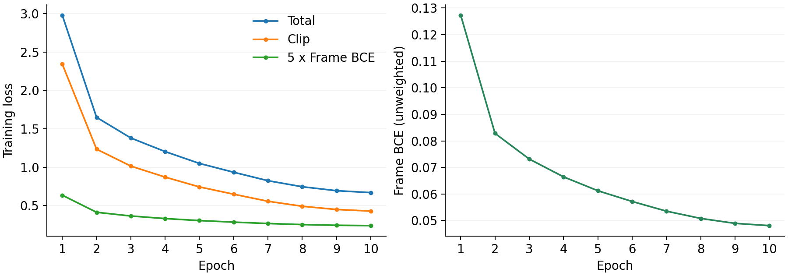

# SED Benchmark 实验总结

更新日期：2026-10-19

## 1. 实验范围

本轮对 DASM、FineLAP、FlexSED、MGA-CLAP、OpenFLAM 五个模型，在 DESED、RealDESED、UrbanSED、TAG、TACOS、MAESTRO 六个 benchmark 上进行评测。使用各模型发布权重与既有推理配置，没有训练或微调。

共完成 40 项“模型 × 数据划分”的推理，其中 35 项已获得当前口径下的指标；其余 5 项对应缺少真值的 MAESTRO evaluation。目标是分析现有模型的能力与瓶颈，不宣称完整复现 COSED。

## 2. 总体结果

| 模型 | DESED Public | DESED Validation | RealDESED | UrbanSED | TAG | TACOS | MAESTRO Dev |
|:---:|:---:|:---:|:---:|:---:|:---:|:---:|:---:|
| DASM | **0.4686** | **0.4194** | 0.1016 | 0.0800 | 0.6205 | 0.1133 | 0.5282 |
| FineLAP | 0.3238 | 0.3244 | 0.1784 | **0.4212** | 0.6479 | 0.1239 | 0.5173 |
| FlexSED | 0.1605 | 0.1453 | 0.0789 | 0.0795 | **0.6485** | 0.1268 | 0.4020 |
| MGA-CLAP | 0.2637 | 0.2807 | **0.1833** | 0.0807 | 0.5076 | **0.1326** | **0.5488** |
| OpenFLAM | 0.0241 | 0.0538 | 0.0643 | 0.2875 | 0.4098 | 0.0878 | 0.5386 |

前四列及 TACOS 为 **PSDS1**，TAG 为 **Grounding PSDS**，MAESTRO 为 **mpAUC**。均越高越好，但不同列不能直接横比或平均。加粗仅表示本列数值最高，不表示统计显著优势。

## 3. 数据范围与计分定义

| 数据划分 | 每个模型的音频数量 | 指标与说明 |
|:---:|:---:|:---|
| DESED Public | 692 | 标准 PSDS1；公开评测集 |
| DESED Validation | 1,068 / 1,168 | 标准 PSDS1；固定使用现有样本进行辅助诊断 |
| RealDESED Test | 1,007 | 标准 PSDS1 |
| UrbanSED Test | 2,000 | 标准 PSDS1 |
| TAG Test | 483 | 995 个文件—短语配对，Grounding PSDS |
| TACOS Test | 2,000 | 5,151 个文件—caption 配对，近义真值合并 PSDS1 |
| MAESTRO Development | 49 | 官方 11 类，1 秒片段 mpAUC |
| MAESTRO Evaluation | 26 | 仅完成推理，没有真值，不能计分 |

### PSDS1

DTC=0.7、GTC=0.7、alpha_CT=0、alpha_ST=1，最大 eFPR=100/小时。使用 `sed_scores_eval` 实现，不包含此前已删除的自定义 0.3/0.3 对照或 PSDS2。PSDS1 不是识别准确率。

### TAG

各文件—短语配对作为评测样本，合并为单一事件类别。DTC=GTC=0.5、alpha_ST=0、最大 eFPR=800/小时。使用本地 v2.2 清单；FineLAP 使用未滤波帧分数，其他模型保留既有分数后处理。不能将此分数与 PSDS1 直接比较。FineLAP 旧三帧滤波结果为 0.6601616055，保留在 legacy 配置；未滤波结果为 0.6479156424，只确认修正了这一处后处理，不代表完整官方复现。

### TACOS

全部文件—caption 配对作为单一事件类别池化评分。主表采用 MiniLM-L6-v2、同一文件内余弦相似度 >0.8 的直接邻居真值合并；不做传递闭包，查询和预测不变。原始 exact-caption 协议也保留，两种配置均可通过统一入口复算。编码器及其他实现尚未获作者确认，不能宣称与 COSED 完全等价。

### MAESTRO

使用全部 49 条 development 录音，而非官方挑战的特定 validation 划分或隐藏 evaluation。选择官方 11 个评测类别，将软标签严格大于 0.5 的区间视为正标签；预测分数按帧与一秒片段的重叠时长加权平均。计算 FPR≤0.1 的阶梯 ROC 曲线面积，除以 0.1 后对类别取平均。共 11,418 个片段，包含末尾不足一秒的片段。

已使用独立逐秒真值与 sklearn ROC 核对每类曲线，面积按 `sed_scores_eval` 规则计算；不是直接使用 sklearn 默认的标准化部分 AUC。

## 4. 主要发现

1. **没有一个模型在所有任务上领先。** DASM 在 DESED 两个划分最高；FineLAP 在 UrbanSED 最高；FlexSED 的 TAG 数值略高于修正后的 FineLAP（0.6485 vs 0.6479），差距很小；MGA-CLAP 在 RealDESED、近义合并 TACOS 与 MAESTRO development 最高。旧 exact-caption TACOS 下 FineLAP 最高，仅适用于旧口径。
2. **模型表现具有明显的任务差异。** FlexSED 的 TAG 分数接近 FineLAP，但在固定类别任务上较弱；OpenFLAM 在 UrbanSED、MAESTRO 相对有竞争力，在 DESED 较弱。不能仅凭这种差异归因于某一种架构设计。
3. **DESED 已出现可追查的类别弱项。** 餐具声在五个模型中普遍偏弱；FlexSED、OpenFLAM 的说话声分数在两个划分中都很低。仍需区分误报、漏报与时间定位的贡献。
4. **TACOS 当前口径下整体分数偏低。** 现有统计不能分离描述理解、时间定位和标注歧义各自的影响，也不能用当前分数推断与 COSED 的性能差距。

## 5. 解释范围与限制

- 各模型在同一数据划分上使用相同样本，但模型训练数据暴露未控制，不作为纯零样本能力排名。
- DESED Validation 缺失 100 条；不再把补齐作为前置条件。后续对照固定使用同一份 1,068 条清单，不假定缺失对结果完全没有影响。
- 本轮未计算置信区间或统计显著性，小幅分差不能直接解释为可靠优势。
- 原始模型分数、类别分布与事件难度不同；跨数据集分差不能直接归因于单一因素。
- MAESTRO evaluation 没有真值，不填零分、不借用 development 标注替代。
- 误报候选需要人工复核，不能把候选数量当作实际误报数量或误报率。

## 6. 下一步分析

按 benchmark 逐个推进，首先分析 DESED Public Test 上的 Speech 与 Dishes，Validation 作为辅助：

1. 对照真值检查事件级误报和漏报，并人工复核代表性案例。
2. 按事件时长、重叠情况和预测边界偏差分组，提出可验证的瓶颈假设。
3. 在 Validation 上选择 query、阈值或后处理配置，再在 Public 上统一评价。

Public 用作固定配置后的主评测。与论文对比时，需确认使用相同划分与指标。暂不引入居家项目的类别优先级和部署要求。

## 7. 文件位置与复算

以下路径相对于 rabbit05 的 `/home/zhanghc/projects/ov-sed/benchmark/`：

| 内容 | 路径 |
|:---|:---|
| 本总结 | `analysis/experiment_summary.md` |
| 可阅读的结果网页 | `analysis/comparison.html` |
| DESED 总体及逐类别结果 | `analysis/desed/official_psds.json` |
| DESED、RealDESED、UrbanSED 详细结果 | `runs-source-audit-v2/模型/数据集/metrics.json` |
| TAG、TACOS、MAESTRO 详细结果 | `runs-extra/模型/数据集/metrics.json` |
| 统一计分入口 | `scripts/score_benchmarks.py` |
| 统一推理入口 | `scripts/run_benchmark.py` |
| 误报候选试听页 | `negative-review/review.html` |

```bash
cd /home/zhanghc/projects/ov-sed/benchmark

# DESED 标准 PSDS1
~/venvs/finelap/bin/python scripts/score_benchmarks.py

# TACOS 与 MAESTRO development
~/venvs/finelap/bin/python scripts/score_benchmarks.py --datasets tacos-test maestro-development
```

## 8. 方法参考

- [DCASE 2023 Task 4：PSDS 配置](https://dcase.community/challenge2023/task-sound-event-detection-with-weak-labels-and-synthetic-soundscapes)
- [DCASE 2024 Task 4：MAESTRO 评测说明](https://dcase.community/challenge2024/task-sound-event-detection-with-heterogeneous-training-dataset-and-potentially-missing-labels)
- [DCASE MAESTRO 计分实现](https://github.com/DCASE-REPO/DESED_task/blob/master/recipes/dcase2024_task4_baseline/local/sed_trainer_pretrained.py)
- [sed_scores_eval](https://github.com/fgnt/sed_scores_eval)
- [TACOS 数据集](https://github.com/OptimusPrimus/tacos)

本报告数值来自本地保存的评测结果，以上链接用于说明指标及数据定义，不作为本地分数的外部验证。


## 逐类统计与训练条件补充（2026-10-19）

[逐类报告](class_results.md) · [简洁三线表](comparison.html)。覆盖全部六个 benchmark、七个有真值的 split；明确区分目标数据集训练暴露、跨数据集直接迁移与尚未核实的同源录音重叠。五个发布权重本轮均未继续微调。

## 8. 协议复算与保存

在服务器 benchmark 根目录执行（不重新推理）：

```bash
~/venvs/finelap/bin/python scripts/score_benchmarks.py --datasets tacos-test --tacos-policy both
~/venvs/finelap/bin/python scripts/score_benchmarks.py --datasets tag-test --models finelap --tag-policy both
```

TACOS 分别写入 `runs-extra/模型/tacos-test/metrics.exact.json`、`metrics.semantic.json`；TAG 分别写入 `metrics.legacy.json`、`metrics.official.json`。`official` 只表示 FineLAP 使用官方 TAG PSDS 的未滤波分数分支。历史 `metrics.json` 保留，不代表新版主表；原始 NPZ 不变。统一启动入口 `scripts/run_benchmark.py` 接受相同配置参数，默认两种都算。

案例页已移除任意阈值及其预测区间，撤回依赖它们的边界、误报与漏报横向判断。既有标准 PSDS、片段 AP 与连续响应曲线仍可用于分析。正式操作点应在验证集按一致规则确定后固定到测试集。

## rabbit02 数据准备核查（2026-10-29）

状态：仅下载标注、核查训练配方，尚未启动训练。源码核查固定在 `ad82bc1e242de4f56b80cf36f6d9f3009bb96c7b`；使用 `git show HEAD:文件` 区分上游代码与本机修改，不覆盖已有 train.py / mix_dataset.py 改动。

### AudioSet Strong：标注已下载，能与现有数据对接

目录：`/work/zhanghc/datasets/AudioSet/metadata/strong/`。

| 文件 | 音频数 | 标注行数 | 用途 |
|---|---:|---:|---|
| audioset_train_strong.tsv | 103,463 | 934,821 | 训练事件起止时间、MID |
| audioset_eval_strong.tsv | 16,996 | 139,538 | 独立测试标注 |
| audioset_eval_strong_framed_posneg.tsv | 14,203 | 958,528 | 960 ms 网格正负标签；不能混同普通事件 TSV |
| mid_to_display_name.tsv | — | 456 | Strong 专用类别名称映射；无表头 |

四个文件由 Google 官方地址下载，经本机中转到 rabbit02，SHA256 两端一致。来源、哈希、数量和映射核查保存在同目录 `download_manifest.json`。原始 TSV 保持不变。

用 WavCaps 的 `as_final.json` 与真实 FLAC 文件名匹配：Strong train 有 **92,450** 条同时具备音频和描述，eval 有 **15,867** 条。103,463 条官方 train 的片段开始时间全部能对上原 AudioSet CSV；这是元数据对齐，不等于逐条验证音频波形截取正确。尚未对共享原始 WAV 库完成 Strong 的逐文件覆盖统计。

现有 WavCaps 合并清单 `wavcaps_merged_sl_ac_train.jsonl` 共 400,812 条，其中包含 **15,710 条 Strong eval**。该清单原本用于其他任务，不能直接视为 AudioSet Strong 官方训练划分。训练构建时必须按官方 train 筛选，并对本次评测集做 ID 排除；不要根据文件名中的 train 或 sl 推断划分/强标注。

全部 456 个 Strong 类别名都在当前 FineLAP 短语库 alternatives 中。官方 train 有一条零时长标注：`vqj-pMnJ9Zg_18000`，9.260–9.260，`/m/07rbp7_`。原文件保留，生成训练标签时排除该事件并记录；不因此丢弃整条音频。

### FineLAP 各数据源的作用

| 数据源 | 如何进入训练 | 当前需要做什么 |
|---|---|---|
| AudioSet Strong + WavCaps AudioSet_SL | 同一音频的 caption + MID 映射名称 + onset/offset | 已具备至少 92,450 条的配对条件；整理 JSONL 并落实评测排除 |
| WavCaps FreeSound / BBC / SoundBible | caption，通常仅全局损失 | 现有文本、音频可用；转换字段、筛选重叠样本 |
| 普通 AudioSet + AudioSetCaps | 使用 AudioSetCaps 提供的描述，仅全局损失 | 原 WAV 已有；还需取得并匹配 AudioSetCaps caption，不用原类别 CSV 冒充描述 |
| AudioCaps / Clotho | 原始人工 caption；Clotho 多参考描述 | 按官方训练划分盘点，不能把本地 AudioCaps test 目录当训练来源 |
| DESED Strong / UrbanSED | 事件名称与区间；需配套非空 clip caption | 对接训练音频和时间标注；作者精确 caption/过滤清单尚未确认 |
| FineLAP-100K | FSD50K 事件前景与背景混合，合成时间标签和 caption | 已有 23/29 分片、79,312 行；补齐发布数据可避免重新生成随机混音 |

依据：`config/data_config/data_eat.yaml` 的十份元数据路径，`utils/make_finelap_data.py` 的 AudioSet_SL 分支，以及 `utils/make_caption_data.py`。前者明确将 Strong TSV 与 WavCaps caption 合并；配置中的 FSD50K 路径指向合成后的 `dev_simulated_sed_data/sed_metadata.jsonl`，并非原 FSD50K 弱标注直接作为强标注。

### FSD50K 合成流程与作者补充

作者 issue #1 已补充：先选只有一个标签的音频，再做能量裁剪，最后保留裁剪时长严格满足 `1 < duration < 7.5` 秒的样本。`filter_energy.py` 的默认阈值为 -50 dB，而论文配方对应的用例显式传入 -20 dB，不能直接运行默认参数。

`simulate_sed_data.py` 接收已经筛选的前景 CSV：每个 10 秒混音抽 1–5 个前景，短于 3 秒的前景尝试重复 1–3 次；同一前景的重复不互相重叠，不同前景允许重叠；SNR 12–20 dB。caption 由事件名填入模板，时间标签来自放置位置。示例使用 Adobe Ambience 背景，但参数默认背景指向 FSD50K 长音频，必须显式指定配方。函数名 `extract_single_events` 并没有实现单标签筛选，而是随机选取已有标签之一，因此前置筛选不能省略。

公开仓库没有包含作者完整的前景/背景清单及最终随机混音配置。复用发布的 FineLAP-100K 与自行重建新混音应分别记录，不能声称音频逐条相同。

### 加载器中影响复现的细节

- `MixDataset` 直接拼接元数据；训练使用普通 DistributedSampler，没有固定数据源比例或强弱监督均衡采样。
- 有 caption 无 phrases 的样本参与全局损失；有有效时间区间的样本额外参与帧级损失。帧级 loss 在有效强标签样本上求均值。
- caption 为列表时随机选一条；模型没有针对空 caption 的全局损失屏蔽。不要依赖转换脚本默认空字符串作为正式联合训练数据。
- 原版读取前 10 秒、取第一声道并重采样至 16 kHz。不是随机裁剪，也不是多声道均值。
- 标签落到 64 帧、每帧 0.15625 秒；onset/offset 都用整除截断，短区间可能落在同一帧边界而没有正帧，需要统计。
- 每条强标签样本最多处理前 20 个正短语，再从非正簇补负短语至 20 个；随机采样同簇替代表述。现有 phrase bank 为 494 行，加载为字典后有 491 个唯一簇、673 个唯一替代表述，Strong 名称已完全覆盖。
- 数据读取失败时原版会回退为零波形，故训练前需剔除缺失/损坏音频，不能仅以训练不报错判断数据有效。
- 公开 train.sh 是 4 卡、每卡 batch 128，实际全局 batch 512；论文写的是 1024。脚本覆盖 YAML 的 epochs，运行 10 轮。后续训练需明确采用哪套；普通梯度累积也不自动等价于增大全局对比学习负样本集合。

### 尚未证实、不能靠文件名猜测的部分

配置中 `_em`、`_filtered` 对应的完整处理流程和最终样本清单未随仓库提供。不能把 `_em` 直接认定为伪强标注或已缓存 embedding；当前加载器仍现场编码文本。论文总体规模只能作为数量级参考，不能替代逐源 train/val/test ID 清单。下一步优先构建并验收 AudioSet Strong + WavCaps 配对，再补 AudioSetCaps 文本和其余训练集，而非重新下载已有音频。

参考：
- [AudioSet Strong 官方文本](https://research.google.com/audioset/download_strong.html)
- [FineLAP 论文 §5.2–5.3、附录 D](https://arxiv.org/html/2604.01155v1)
- [固定版本数据配置](https://github.com/xiquan-li/FineLAP/blob/ad82bc1e242de4f56b80cf36f6d9f3009bb96c7b/config/data_config/data_eat.yaml)
- [AudioSet Strong 转换脚本](https://github.com/xiquan-li/FineLAP/blob/ad82bc1e242de4f56b80cf36f6d9f3009bb96c7b/utils/make_finelap_data.py)
- [FSD50K 预处理作者答复](https://github.com/xiquan-li/FineLAP/issues/1#issuecomment-4260280522)
- [AudioSetCaps 来源及评测排除说明](https://github.com/JishengBai/AudioSetCaps)

## COSED 数据组合试训（2026-10-29）

目的：保留 FineLAP 的 EAT + RoBERTa + Transformer 时序头和原损失，改用 COSED 的五源数据及重复采样倍数。此次是第一轮工作基线试验，不是 COSED 模型或其完整训练配方的复现。

状态更新（2026-10-30）：下载和转换全部完成。10月29日首次完整训练在第一轮内因坏 FLAC 退出，没有完整 epoch checkpoint；现先逐文件解码审计、记录并排除不可用条目，再从原初始化重启。实时状态以 `exps/finelap_cosed_mix_20261029/status.json` 为准，不能把 smoke 权重当正式实验结果。

### 数据与采样

| 数据源 | 本轮音频数 | 每轮重复次数 | 每轮样本数 |
|---|---:|---:|---:|
| AudioSet Strong train | 102,830 | 1 | 102,830 |
| FineLAP-100K | 100,000（补齐后） | 1 | 100,000 |
| AudioCaps train | 49,063 | 2 | 98,126 |
| TACOS development | 10,358（音频传输完成后） | 5 | 51,790 |
| Clotho development | 3,839 | 4 | 15,356 |
| 合计 | 266,090 个源内条目 | — | 368,102 |

合计不是跨数据源去重后的独立音频数量，AudioCaps 和 AudioSet 可能共享音频。重复次数通过重复 JSONL 路径、拼接后统一打乱实现；每个 batch 不保证固定源占比。来源为 [COSED §3.2](https://arxiv.org/html/2609.30083v1#S3.SS2)。

- AudioSet 使用官方 Strong train；253 条未匹配，380 条因 TAG 测试或 AudioCaps 验证/测试重叠被排除。时间范围零长度的 1 个事件排除，保留原始 TSV。
- AudioCaps 使用官方 train CSV，按音频合并描述；缺失和排除明细保存在 `data/cosed/source_audit.json`。AudioSet 与 AudioCaps 均排除 TAG test 和 AudioCaps val/test 的视频 ID。
- TACOS 只用 development，test 不进入训练。**论文额外排除了 1,401 条含语音训练音频，精确名单未取得；本轮使用完整 10,358 条公开 development。** 不用元数据中的 Speech 字段冒充那份排除名单。
- Clotho 只用 development，5 条参考描述中每次随机选择一条。
- 超过 10 秒的音频随机裁剪，强标签与裁剪区间相交并平移。被裁掉全部正事件的强标注音频仍保留全负帧监督。弱描述仍是原整段 caption，可能不完全适配某次裁剪。
- AudioSet 全局 caption 优先取 WavCaps；10,752 条无该描述的样本使用事件名模板。这是适配 FineLAP 全局损失的处理，不等同 COSED 的 class-query 监督。
- TACOS 自由文本短语按原文保留，未知短语沿用 FineLAP 原有回退逻辑；负采样仍使用原 phrase bank，没有加入 COSED 的跨数据源监督掩码或其固定 447 类查询机制。
- 不直接加入 DESED、UrbanSED、其余 WavCaps、普通 AudioSetCaps。FSD50K 在本轮通过发布的 FineLAP-100K 合成数据参与。

### 本轮训练设置

rabbit02 使用 GPU 2、3、4；0、1 号卡已有任务。每卡 batch 32，全局 96；BF16；10 epochs；学习率 5e-5；seed 31415926。保留 FineLAP 原优化器与调度实现，clip/frame loss 权重为 1/5；本配置未启用蒸馏。固定训练 10 轮、逐轮保存，不根据六个 benchmark 测试分数挑选 checkpoint。

从 `weights/EAT-base_epoch30_ft.pt` 和 `weights/roberta-base` 初始化，`ckpt_path` 为空，不从 `finelap_fixed.pt` 继续训练。全局 batch 与 COSED 论文的 1024、40 epochs 不同；架构、初始化、损失等也保留 FineLAP。不能把后续与发布模型的涨跌直接归因于单一数据源。

环境为 `/work/zhanghc/miniconda3/envs/finelapt/bin/python`。本项目独立使用 `dependencies/fairseq`，上游 commit 为 `3d262bb25690e4eb2e7d3c1309b1e9c406ca4b99`，通过训练进程的 PYTHONPATH 指定；未修改共享 `/work/zhanghc/fairseq`。读取器指定 soundfile 后端以支持 TACOS MP3；读取失败立即报错，不默默替换成静音。

已完成：已知区间的裁剪/平移检查、全负裁剪监督检查、帧级 BCE 反向检查、三卡 batch 32 的 3 步联合训练、有限 loss 和 checkpoint 保存。短测试只是可运行性检查，不是收敛或效果结论。

### 查看与运行

所有下列命令在 rabbit02 执行。入口只有数据准备和后台串行流程两个；仍调用原 `train.py`。

```bash
cd /work/zhanghc/Myllm/FineLAP
cat exps/finelap_cosed_mix_20261029/status.json
tail -n 30 exps/finelap_cosed_mix_20261029/pipeline.log
# stage 为 training 后查看训练进度：
tail -f exps/finelap_cosed_mix_20261029/train.log
```

后台流程 `scripts/train_cosed.py` 当前已运行，不要重复启动。它依次补齐下载、验证 TACOS 官方 MD5、生成五源清单、核对 100,000/10,358 数量、检查短测试记录和空闲 GPU，再启动完整训练。断开本机或 VPN 不会主动结束服务器上的后台进程；下载失败则记录 failed，不会用残缺数据直接训练。

如流程失败，先查看 `status.json` 指向的日志。正式训练未开始时，可修复问题后用下面命令继续下载和准备；已有分片及断点会保留：

```bash
cd /work/zhanghc/Myllm/FineLAP
nohup /work/zhanghc/miniconda3/envs/finelapt/bin/python -u scripts/train_cosed.py >> exps/finelap_cosed_mix_20261029/pipeline.log 2>&1 < /dev/null &
```

训练中断后，不要直接重跑此下载入口来假装断点训练。原 `train.py --resume_from` 可从最后完整 epoch 的 `models/last_epoch.pt` 恢复；须使用已保存的同一配置和 GPU/batch 设置，未完成 epoch 会重跑。完整训练日志、配置、逐轮 checkpoint、loss CSV/JSON/曲线均在 `exps/finelap_cosed_mix_20261029/`，短测试单独放在同级 `_smoke/`。

数据转换入口为 `utils/prepare_cosed_data.py`；正式清单为 `data/cosed/*.jsonl`，数量及差异说明在 `mixture.json`。`mixture_smoke.json` 仅用于短测试，不代表正式训练覆盖。原数据、原模型、既有 benchmark 结果保留。

### 2026-10-30 重启与音频完整性检查

前次完整训练于 10月29日 17:44 启动、17:54 退出。出错的 WavCaps 文件 `Y3sSblRfEG2o.flac` 头信息异常，soundfile 解码失败，sox 解码为零帧；不能以换解码器或填静音解决。

`utils/prepare_cosed_data.py --validate-existing` 对五源清单中去重后的 257,177 个音频逐一解码，检查时长、解码帧数和有限数值。异常文件不删除，异常路径、原因、各源排除 ID 和排除前数量写入 `data/cosed/audio_validation.json`；仅重写本轮训练清单并更新 `mixture.json`，五源重复倍数保持不变。表格中原数量为排除前数量，最终数量以 mixture.json 为准。

启动入口增加 `--prepared`，复用已准备且通过审计的清单，不再重复提取音频。已有正式 checkpoint 时拒绝从头覆盖，需显式选择恢复；此次没有完整 checkpoint，因此从 EAT/RoBERTa 初始化开始。当前后台使用 `--prepared --wait-validation` 等待本次审计成功后启动，审计失败则停止，不会绕过检查。

```bash
cd /work/zhanghc/Myllm/FineLAP
cat exps/finelap_cosed_mix_20261029/status.json
tail -n 10 exps/finelap_cosed_mix_20261029/prepare_full.log
# stage=training 后：
tail -f exps/finelap_cosed_mix_20261029/train.log
```

原失败日志保留，新日志追加到同一个实验目录。启动参数显式指定 `--alpha 1 --beta 5`，其余维持 GPU 2/3/4、batch32/卡、BF16、10 epochs。

本次审计结果：257,177 个独立文件中 5 个 FLAC 时长头异常；排除 AS Strong 5 条、AudioCaps 1 条（其中一个坏文件被两源共用）。最终 AS Strong 102,825、FineLAP100K 100,000、AudioCaps 49,062、TACOS 10,358、Clotho 3,839；每 epoch 重复采样合计 368,095。完整训练于 2026-10-30 01:03 在服务器重新启动，实时进度仍以 status.json/train.log 为准。

### 训练完成（2026-10-30）

完整运行于 01:03 启动、15:08 完成，约 14 小时 5 分钟；10 epochs、每轮 3,835 步，共 38,350 次优化器更新。status.json 为 completed，GPU 2/3/4 已释放。epoch_001.pt 至 epoch_010.pt 和 last_epoch.pt 均保存；last_epoch.pt 已在 CPU 读取核查。

日志记录的 epoch 平均 loss（主进程日志，不另称全卡聚合均值）：

| Epoch | Total | Clip | Frame BCE（未乘5） |
|---|---:|---:|---:|
| 1 | 2.9798 | 2.3432 | 0.1273 |
| 5 | 1.0504 | 0.7443 | 0.0612 |
| 10 | 0.6701 | 0.4296 | 0.0481 |

训练损失逐轮下降且有限；不能仅凭训练 loss 判断泛化能力或胜过发布模型。本轮固定使用第 10 轮 checkpoint，未按测试集挑 epoch；六套 benchmark 与独立 DESED Validation 已完成，见下方完整结果。

最终权重：`/work/zhanghc/Myllm/FineLAP/exps/finelap_cosed_mix_20261029/models/epoch_010.pt`。逐轮数值与曲线仍使用原目录的 `metrics/train_loss.json`、`metrics/train_loss.csv`、`plots/train_loss_curve.png`。

### 第 10 轮权重测评（2026-10-30）

最初入口：`scripts/evaluate_cosed.py`，GPU 2，在 rabbit02 运行；后迁移至 rabbit05 GPU 5 并于 17:26 完成。原计划依次评估 DESED Public、DESED Validation、TAG、TACOS、UrbanSED、RealDESED、MAESTRO development；Public/Validation 分开，MAESTRO development 不称公开测试集。复用 rabbit05 冻结的 core/grounding runner 和 score_benchmarks.py，其文件哈希与 checkpoint SHA256 记录在实验的 evaluation/provenance.json。原版 FineLAP 结果保留，没有覆盖。

直接使用原生 FineLAP 构造器，严格加载本次 epoch_010.pt；沿用既有查询、16kHz/第一声道预处理、窗口、后处理和计分。TAG 主结果使用未滤波 raw；TACOS 同时报告 exact/semantic，semantic 复用相同 MiniLM 编码器和原查询生成的近义区间。计分库 sed_scores_eval 0.0.4 单独安装在 dependencies/scoring，不替换训练环境依赖。音频通过 soundfile 解码。

rabbit05 GPU 均被其他任务占用，因此通过 VPN 内网只读传输公开 benchmark 音频，在 rabbit02 `/work/zhanghc/datasets/cosed-benchmarks/audio` 缓存，TACOS 已有文件优先复用。首轮包含传输时间；每份音频传输完整后原子保存，预测可断点续跑。

结果位于 `exps/finelap_cosed_mix_20261029/evaluation/`：status.json 为队列状态，evaluate.log 为日志，summary.json 为已完成数据集成绩，runs-source-audit-v2/runs-extra 内保存逐帧预测与指标。训练 loss 图仍在 plots/train_loss_curve.png，现拆分加权贡献和未加权 Frame BCE；当前没有验证 loss 曲线，也不能从训练曲线断言过拟合与否。



### 首个测评结果：TACOS test（2026-10-30）

已完成全部 2,000 条音频、5,151 个音频–文本查询配对。与发布 FineLAP 的旧结果核对，manifest SHA256、PSDS1 参数和两种标注合并口径一致。训练清单与该测试集音频文件名交集为 0。分数越高越好。

| TACOS PSDS1 口径 | 发布 FineLAP | 本轮 epoch 10 | 差值 |
|---|---:|---:|---:|
| Exact caption | 0.0766 | 0.2143 | +0.1377 |
| Semantic caption（主对比口径） | 0.1239 | 0.2444 | +0.1205 |

本轮包含 TACOS development 训练监督，且数据组合、batch、训练过程不同于发布权重；不能把提升单独归因于结构或某个采样倍率，也不是未见数据集上的零样本成绩。与 COSED 论文的精确测试划分及语义编码器等仍未完全确认，不以本结果直接宣称超过 COSED。

完整指标：`evaluation/runs-extra/finelap/tacos-test/metrics.exact.json` 与 `metrics.semantic.json`；原始预测保留。其余数据集已完成，最终结果见下表。


### 六套 benchmark 测评完成（2026-10-30 17:26）

固定 epoch 10；已完成六套 benchmark，以及单独计分的 DESED Validation。表中“原版”是此前发布权重的本地复测，不是论文原始数字。每项指标均越高越好，不同指标之间不直接横向比较。

| 数据集 / 指标 | 原版 FineLAP | 本轮 epoch 10 | 差值 |
|---|---:|---:|---:|
| DESED Public / PSDS1 | 0.3238 | 0.2324 | -0.0914 |
| RealDESED test / PSDS1 | 0.1784 | 0.0812 | -0.0973 |
| UrbanSED test / PSDS1 | 0.4212 | 0.2254 | -0.1959 |
| TAG test / grounding PSDS（未滤波） | 0.6479 | 0.6268 | -0.0211 |
| TACOS test / PSDS1（semantic） | 0.1239 | 0.2444 | +0.1205 |
| MAESTRO development / mpAUC | 0.5173 | 0.4188 | -0.0984 |
| DESED Validation / PSDS1（辅助） | 0.3244 | 0.2234 | -0.1010 |

核查：七项的清单内容与原 benchmark 清单 SHA256 一致，计分参数与冻结原版结果一致；预测数量依次为692、1007、2000、483、2000、49、1068，均与本轮输入清单一致。DESED Validation 相对官方1168条仍缺100条，沿用此前接受的1068条子集；MAESTRO使用49条development，不能称官方测试集。TAG保留legacy滤波结果0.6394451244，主表采用raw分支0.6268471959；TACOS保留exact结果0.2143399380。

迁移验证：仅移除optimizer后传输的推理权重通过SHA256；rabbit05与rabbit02三条DESED音频的标签、时间戳和raw/scores完全一致（六项最大绝对误差均为0）。这验证了抽查样本的跨机一致性，不扩展成对所有输入的等价性证明。实测该检查的PyTorch显存峰值allocated0.97725GiB、reserved1.03320GiB。

结果解读：本轮只有TACOS总体提升；TAG小幅下降，RealDESED、UrbanSED和MAESTRO也下降。因此不能只用“缺少DESED训练集”解释全部差距。任务采样、监督有效性、训练量等仍是待验证因素；当前结果不足以认定某一结构或机制是原因。MAESTRO类别也并非全部下降：footsteps和cutlery and dishes略有改善，需要保留类别层面的差异。

最终结果目录（rabbit05）：`/home/zhanghc/projects/ov-sed/FineLAP/exps/finelap_cosed_mix_20261029/evaluation/`，summary.json与逐帧预测均保留，原版成绩未覆盖。02保留原训练检查点与迁移前预测；本轮测评已结束，benchmark数据补传是另一项后台任务。

### FineLAP 公开代码配方重建训练（2026-11-02）

实验 finelap_original_20261031 已完成全部 10 轮，训练计时合计约 61.96 小时。实际数据 2,322,976 条，四卡真实总 batch 512、FP32、Clip/Frame 权重 1:1。原作者最终过滤清单未公开，数据重建差异见 rabbit02 的 resources/training.md 和本实验 provenance.json；不称严格逐条一致复现。

| Epoch | 总训练 loss | Clip | Frame |
|---:|---:|---:|---:|
| 1 | 3.7656 | 3.6381 | 0.12746 |
| 5 | 2.5619 | 2.4973 | 0.06459 |
| 9 | 2.2222 | 2.1690 | 0.05322 |
| 10 | 2.1961 | 2.1432 | 0.05289 |

最后一轮总loss下降约1.18%，训练目标趋稳，但没有验证曲线，不能据此判定PSDS收敛或排除过拟合。10份逐轮checkpoint与last_epoch均保存。第10轮六benchmark及独立DESED Validation测评已在rabbit02 GPU0启动，结果单独保存于 `/work/zhanghc/Myllm/FineLAP/exps/finelap_original_20261031/evaluation/`，日志在 `/work/zhanghc/Myllm/FineLAP/log/20261102/original_evaluation.log`。沿用之前冻结的协议与清单，旧表中的COSED-mix实验分数不能当成本轮成绩；测评现已完成，最终对比见下表。

本轮六套 benchmark 与独立 DESED Validation 已全部完成；全部逐帧预测数量匹配冻结输入清单，runner 哈希和清单 SHA256 与上一轮一致。下列“发布版”均为本地复测，不是直接抄论文分数。

| 数据集 / 指标 | 发布版 FineLAP 本地复测 | 上轮 COSED-mix | 本轮公开代码配方重建 |
|---|---:|---:|---:|
| DESED Public / PSDS1 | 0.3238 | 0.2324 | 0.3401 |
| RealDESED / PSDS1 | 0.1784 | 0.0812 | 0.1904 |
| UrbanSED / PSDS1 | 0.4212 | 0.2254 | 0.4277 |
| TAG / raw grounding PSDS | 0.6479 | 0.6268 | 0.6566 |
| TACOS / semantic PSDS1 | 0.1239 | 0.2444 | 0.1209 |
| MAESTRO development / mpAUC | 0.5173 | 0.4188 | 0.5398 |

辅助 DESED Validation：本轮 0.3325，发布版本地复测 0.3244，上轮 0.2234。沿用 1068 条可用音频，缺少的 100 条不变。MAESTRO 此处为 development，不应当作论文同划分成绩。TACOS semantic 的编码器和原论文精确划分等仍未完全确认；exact 口径本轮为 0.0817727013，与 semantic 分开保留。TAG 主结果为未滤波 raw，legacy 为 0.6682903868，不混入主表。

结果解释：本轮五项分数高于发布版本地复测，TACOS 略低，整体回到接近发布版的水平。不能把多源配方、训练曝光、batch、损失权重和训练量同时变化后的收益归因于单一因素。上轮含 TACOS development 监督，本轮没有，这是 TACOS 差异的重要背景，但不是受控消融证据。训练 loss 趋稳且末轮测评合理；尚无中间轮验证成绩，因此不宣称第10轮是最优 checkpoint 或已经证明无过拟合。

### 五源 FineLAP 数值精度对照（2026-11-04）

两组使用相同的五源清单、采样倍率、种子、总 batch 96、Clip/Frame 权重 1:5 和 10 轮训练。FP32 组另启用激活重计算。第 10 轮训练 loss 分别为 BF16 0.67006、FP32 0.67202，训练计时分别为 14.06 和 27.15 小时。以下为第 10 轮权重在同一清单、同一 runner 及计分协议上的结果。

| 任务 | 音频数 | BF16 | FP32 | 差值（FP32−BF16） |
|---|---:|---:|---:|---:|
| DESED Public · PSDS1 | 692 | 0.2324 | 0.2283 | -0.0041 |
| RealDESED · PSDS1 | 1007 | 0.0812 | 0.0926 | +0.0115 |
| UrbanSED · PSDS1 | 2000 | 0.2254 | 0.2246 | -0.0008 |
| TAG · raw grounding PSDS | 483 | 0.6268 | 0.6335 | +0.0066 |
| TACOS · semantic PSDS1 | 2000 | 0.2444 | 0.2445 | +0.0001 |
| MAESTRO development · mpAUC | 49 | 0.4188 | 0.4673 | +0.0484 |
| DESED Validation（辅助）· PSDS1 | 1068 | 0.2234 | 0.2308 | +0.0074 |

MAESTRO development 上增幅最大。DESED Public、UrbanSED 和 TACOS 的差值均小于 0.005（绝对值）。本次单种子结果表明，换成 FP32 后，五源实验与十源配方之间的主要差距仍然存在。训练耗时包含激活重计算。DESED Validation 沿用可用的 1068 条，MAESTRO 为 development，TACOS 主表为语义合并口径。完整结果在 rabbit02 的 /work/zhanghc/Myllm/FineLAP/exps/finelap_cosed_fp32_20261102/evaluation/summary.json。

### COSED 论文重建（2026-11-04 启动）

本次直接实现 COSED 双编码器、两层 BiGRU、两路 focal 监督、同来源掩码与分块归一化。训练入口与已完成的 FineLAP 五源实验分开维护，见 [COSED 运行说明](../cosed/README.md)。rabbit02 项目位于 `/work/zhanghc/Myllm/COSED`。ATST-F weak 权重严格载入，MGA-CLAP 文本塔在三条固定查询上与原生输出最大绝对误差为 9.13e-8。当前重建有 210,845,956 个参数。

四卡两步预检使用真实五源训练记录和总 batch 1024，得到有限损失与非零梯度。EMA 在 64 条 AS-S 预检音频上完成 PSDS1 计分和保存，七个下游划分各一条的推理输出均有限、时间戳递增、帧间隔 40 ms。正式 AS-S 选模使用本地可计分的 16,893 条、407 类。单种子正式训练独立保存于 runs/seed31415926，最多 40 轮，连续 10 轮 PSDS1 不升则停止，随后评测最佳 EMA 权重。实际停止情况与补测结果见下表。

主要差异包括使用 4 张 3090 和全批查询下的分块更新，TACOS 本地筛除 453 条明确的 Speech 记录后使用 9905 条，作者精确的 1401 条排除名单未知。只落实公开的 ontology 改边示例，提示模板、增强参数、BiGRU 宽度和文本读出按 README 中记录的实现选择，使用原 TACOS 文本。当前单个种子与论文三种子均值分别记录。

### COSED 重建实测（2026-11-05）

第 10 轮训练收到 KeyboardInterrupt，最后记录为 step 3330。9 个完整 epoch 的 AS-S EMA 验证 PSDS1 均为 0（16,893 条、407 类）。严格按改善保存的 best.pt 对应第 1 轮；第 9 轮为 last.pt 中的 EMA。两份权重使用同一冻结清单独立补测。

| 测试集 | 第 1 轮 EMA | 第 9 轮 EMA | COSED 论文 |
|---|---:|---:|---:|
| DESED Public | 0.0000 | 0.0000 | 0.437 |
| RealDESED | 0.0000 | 0.0000 | 0.224 |
| UrbanSED | 0.0009 | 0.0000 | 0.234 |
| TAG | 0.3022 | 0.2991 | 0.648 |
| TACOS | 0.0413 | 0.0379 | 0.187 |
| MAESTRO（本地 development） | 0.0759 | 0.0757 | 0.643 |

论文列取自 [表 1](https://arxiv.org/html/2609.30083v1#S2.T1)。TAG 为 grounding PSDS；MAESTRO 为 mpAUC，本地划分与论文的可比性有限；其余为 PSDS1。TACOS 主表合并近义 caption，exact 两轮分别为 0.0134、0.0075。第 9 轮在线权重单独补测 DESED Public，也为 0.0000。

在固定提示模板下，447 个 AS-S 类两两文本余弦相似度的中位数从初始化的 0.29530 升至第 9 轮 EMA 的 0.99997，同轮在线权重为 0.86305。DESED 的 10 个类在 EMA 上为 0.99998，10 个查询权重最高的 codebook 条目相同。692 条 DESED Public 音频上，第 9 轮 EMA 的片段宏 AUROC 为 0.4957（每类帧分数取最大值），逐帧宏 AUROC 为 0.5252（以帧中心判断 GT）。分数反映出查询区分度显著退化。全部 102,825 条 AS-S 训练记录中的 429,388 个带时间段的短语条目均可映射到至少一个监督类。训练中哪一步驱动这种退化仍待受控实验。

原始 summary.json 在 rabbit02 的 `/work/zhanghc/Myllm/COSED/runs/seed31415926/` 下，第 1、9 轮 EMA 分别在 `benchmark_085b31068486`、`benchmark_484114fd9765`。第 9 轮在线权重的诊断结果另存于 `benchmark_484114fd9765_online`。

**训练实现审计（2026-11-05）**　使用归档源码重放正式首批（种子 31415926，4 卡，1024 条，保留原增强及掩码，学习率设为零）。原版 loss 0.18490705，与原始日志一致，但 cuDNN BiGRU 实际输出为 FP16，16 组参数的梯度全为零。第 9 轮在线 checkpoint 中，16 组对应的 Adam 一阶和二阶矩均为零；对分布于全部 16 组的 8464 个参数重放 3213 步纯 AdamW 权重衰减，与保存值逐位相同。修正仅让 BiGRU 与其输出归一化使用 FP32；同一批次 loss 显示相同，16/16 组均收到非零梯度，BiGRU 合计梯度范数 0.00070860。旧表为存在此错误的运行结果；修正后尚无完整训练成绩。不能用旧分数判断 COSED 的监督或结构优劣。

2026-11-05 已从原始初始化启动修正版 seed31415926_grufp32。rabbit02 GPU 0–3，五源配方、总 batch 1024 和种子同前。正式首步 loss 0.18490705，BiGRU 16/16 组有梯度，合计范数 0.00070860；后续每 100 步记录时序分支梯度，每轮以 AS-S EMA PSDS1 验证。

### 修正版 COSED 中间评测（2026-11-06）

训练进行至第 10 轮、第 3290 步，最近 batch loss 0.0406062。已完成的 9 轮 AS-S EMA 验证 PSDS1 全部为 0。第 3200 步 BiGRU 16/16 组梯度非零，合计范数 0.00110524；第 9 轮 checkpoint 对应 16 组 Adam 一阶、二阶矩均有非零值。

用空闲 GPU4 对第 9 轮、第 3213 步权重完成 DESED Public 692 条全量中间评测。片段分数取每类帧分数最大值，逐帧 GT 以帧中心判断。

| 权重 | PSDS1 | 片段 mAP | 片段宏 AUROC | 逐帧宏 AUROC |
|---|---:|---:|---:|---:|
| EMA | 0.0000 | 0.1791 | 0.5141 | 0.5678 |
| 在线 | 0.0000 | 0.1928 | 0.5415 | 0.6223 |

固定提示模板下，447 类文本两两余弦相似度中位数初始化为 0.29530，第 9 轮 EMA 为 0.999989，在线权重为 0.84391。时序头已有有效梯度，文本表示退化仍然存在；根因未确定。当前训练继续运行，中间 benchmark 成绩仅用于诊断。预测及评分保存于 rabbit02 /work/zhanghc/Myllm/COSED/runs/seed31415926_grufp32/benchmark_81a95a716e8f 与同名 _online 目录。
进一步复算第9轮 DESED Public 的 PSDS 曲线。在原 DTC/GTC=0.7 和 max_eFPR=100/hour 下，EMA 十类曲线的召回均为零，alpha_st=0 时仍为零。在线权重取消类别差异惩罚后面积为0.02331517、平均召回曲线最高0.04416134；标准 alpha_st=1 后有效召回曲线全为零。在线最高类别召回分别为 Vacuum_cleaner 0.166667、Blender 0.130952、Electric_shaver_toothbrush 0.101852，Cat/Dog/Running_water为零。这些是误报预算内的事件召回，不能解释成所有阈值下都没有正确预测。

2026-11-06 校准与正负梯度诊断：随机种子193抽取32条AS-S训练音频（含祖先正标签，正例比例0.98546%），eval模式使用固定sound of模板，不执行优化步。对类别块0.9权重下的正负focal项分别求各logit导数绝对值之和，初始化正/负比为2,411,453，第9轮EMA为18.386，在线权重为0.9353。对应正/负音频文本余弦均值为初始化0.00993/0.00822、EMA 0.98467/0.98417、在线0.97643/0.72835。这支持初始校准使负例排斥信号极弱、EMA仍趋同的机制假设；在线权重在该训练样本上已出现正负分离。结果只涉及AS-S类别块和logit梯度，不能外推为整个五源参数梯度的比例，不能据此确认塌缩的唯一根因。当前实现的scale*cos+bias与tau=0.1,b=-10按论文文字实现，作者实际参数化仍需核实。

2026-11-06 用户决定暂停 COSED 复现。训练及自动评测启动器已退出，GPU已释放。停止时最近日志为第11轮step3800；可恢复断点为第10轮step3570（包含优化器和EMA）。第10轮AS-S验证PSDS1仍为0，等待作者澄清实现细节。

### 暂停后的第10轮评测与假设（2026-11-06）

只对保存的epoch10/step3570权重补测，训练保持暂停。DESED Public 692条，EMA/在线PSDS1分别0.0/0.0001203478957513883，片段mAP 0.162114/0.193505，片段宏AUROC 0.487400/0.533274，逐帧宏AUROC 0.600303/0.633809。相同32条AS-S训练样本、固定提示、eval模式，EMA正负音频文本余弦均值0.968370/0.955848，在线为0.928414/0.553964；对应类别块正负logit梯度绝对值之和的比值5.83771/1.05964。447类文本两两余弦中位数为EMA 0.999376、在线0.907195。输出目录为runs/seed31415926_grufp32/benchmark_d8258c7e1055及_online。

优先假设为初始scale=0.1、bias=-10与focal共同造成极弱负例梯度，使表示先趋同；当前在线权重逐步出现分离。EMA0.999对应约693步半衰期（本次约1.94轮），可能延迟反映恢复，但在线模型测试表现也很弱，无法仅归因EMA。MGA codebook读出、作者实际校准参数化、五源损失/跨卡实现等仍需受控验证。上述属于待检验假设，尚无单因素重新训练的因果证据。

### 整批与分块梯度等价性审计（2026-11-06）

使用第10轮在线权重，固定种子193从五个来源各取4条真实音频，共20条；固定裁切、提示词、标签，关闭mixup、其他随机增强和dropout。BiGRU保留反传所需train模式（其dropout为0）。优化器学习率0，读取全部参数裁剪前梯度；TF32关闭。整批参考独立建立全尺寸frame/clip目标与同来源布尔mask，使用softplus实现focal；被测路径直接调用实际train.update。另执行真实4卡all_reduce，micro=2。脚本为 /work/zhanghc/Myllm/COSED/audit_gradients.py，机器可读结果为该项目log/gradient_audit.json，本地同名JSON镜像在cosed目录。

| 来源 | 整批查询数 | 有效监督条目 | 正例标签总量 Σy | 负例标签总量 Σ(1−y) |
|---|---:|---:|---:|---:|
| AS-S | 447 | 447000 | 5030 | 441970 |
| FineLAP-100K | 9 | 9000 | 774 | 8226 |
| AudioCaps | 4 | 16 | 4 | 12 |
| TACOS | 6 | 6000 | 970 | 5030 |
| Clotho | 4 | 16 | 4 | 12 |

被测全局query_bank和每条targets均与独立参考逐元素相同。分母分别为类别块447000、强caption正1744/负13256、弱caption正8/负24。当前路径显式先建立整个逻辑batch的查询池和分母，再切音频；本批跨微批/跨卡负例得到保留。若按每个micro=2单独建池，本批AudioCaps每微批最多1个查询，从而失去其他音频caption负例，但实际update没有执行这种局部建池。

发现音频预处理依赖batch组成。ATSTMel把形状[B,F,T]送进top_db=80的AmplitudeToDB，库将其视作[channel,F,T]，共享单个截断参考。20条整批与micro=2的归一化Mel最大差0.18509。原始输入下，FP32四卡累积对整批的BiGRU梯度相对L2差为0.22163，音频0.05992，文本0.03890。这些差异不能归到loss/mask归一化上。

固定相同Mel后，FP32 loss：整批0.0398244336247，micro2及micro8均为0.0398244336247，四卡micro2为0.0398244373500。

| 模块 | 固定Mel四卡累积相对整批梯度L2差 |
|---|---:|
| 音频编码器 | 1.35e-6 |
| 文本编码器 | 8.67e-7 |
| BiGRU | 1.74e-6 |
| Clip头 | 3.85e-7 |
| scale | 8.51e-8 |
| bias | 1.01e-7 |

固定Mel的BF16路径仍存在数值差异。micro2对同精度整批的loss相对差约0.036%，模块梯度相对差约0.028%–0.861%，梯度方向余弦均大于0.99996。此项只测试单卡，四卡对照采用FP32。

只在诊断中将Mel显式变成[B,1,F,T]后做dB截断，整批与micro2最大差降到4.83e-5，micro8降到2.38e-7，与旧单条预处理差也不超过4.83e-5。尚未修改正式预处理或启动训练。

训练模式还存在分块相关随机性：文本dropout在各rank使用不同种子；mixup只在本卡微批的同来源样本间配对；频率增强按当前微批随机取样。因此固定随机种子并不保证不同分块得到相同增强样本。上述随机路径没有通过本次关闭随机性的梯度等价检查。当前证据支持本批全局负例池、mask、归一化与梯度求和等价，发现的预处理及随机性差异是否造成表示坍缩仍待因果实验。

### 文本与音频表征直接核查（2026-11-06）

训练保持暂停。对修正版第10轮、step3570的同一checkpoint分别检查在线权重和EMA，并与种子31415926的原始初始化比较。checkpoint SHA256为d8258c7e1055174e8c9b0da77b04af7098a3dec5085889cd870d990f68da2133。五个训练来源各抽10条真实音频，固定种子193，50条路径和裁切均不同，全部非静音（补齐10秒后的RMS范围0.001049–0.288517）。使用447个固定模板类别查询和这50条音频的50个不同caption。所有状态共享逐条预先计算的Mel，FP32、eval模式、无增强、无dropout；每条音频均匀取10帧。

下表文本为不同查询之间的余弦中位数，音频帧仅统计**不同音频之间**的配对，排除同一音频内相邻帧自然相似的影响。Clip表示为不同音频的片段向量。

| 表征位置 | 初始化 | 第10轮在线 | 第10轮EMA |
|---|---:|---:|---:|
| 447类文本query | 0.295299 | 0.907195 | 0.999377 |
| 50条caption query | 0.154640 | 0.961331 | 0.998839 |
| ATST音频编码器帧输出 | 0.202819 | 0.885398 | 0.998793 |
| BiGRU帧输出 | 0.195336 | 0.989266 | 0.999745 |
| Clip头输出 | 0.457967 | 0.927042 | 0.999996 |

进一步对单位长度表征中心化，计算总方差V=mean(||x−mean(x)||²)，以及协方差特征值归一化后的熵有效秩exp(−Σp log p)。前者量化剩余变化的绝对大小，后者量化这些变化分布在多少个方向；两者必须一起看。下面每格为“总方差 / 有效秩”。帧表征使用500帧，文本447条，Clip向量50条；有效秩比较限于同一行。

| 表征位置 | 初始化 | 第10轮在线 | 第10轮EMA |
|---|---:|---:|---:|
| 447类文本query | 0.691986 / 111.69 | 0.192198 / 4.05 | 0.001224 / 1.48 |
| ATST音频编码器帧输出 | 0.778588 / 71.95 | 0.148055 / 8.34 | 0.002217 / 9.67 |
| BiGRU帧输出 | 0.787628 / 64.10 | 0.036358 / 4.17 | 0.001336 / 3.11 |
| Clip头输出 | 0.528421 / 38.18 | 0.138341 / 1.38 | 0.00000511 / 3.92 |

在这批样本上，EMA文本及音频两个分支均出现严重方向趋同，接近常量表示；证据已不限于文本query。在线权重保留了更多变化，但变化集中在少数方向，尤其BiGRU输出的跨音频余弦中位数达0.9893，不能据此称为表征正常。初始化BiGRU和Clip头是随机权重，所以初始化只用于分布参考，不是检测能力基准。高余弦或低有效秩单独都不能证明检测失败；本次结合总方差和既有低评测分数，支持“严重趋同/低维退化”的描述，但没有确认根因，也不能推断训练到何时一定恢复。

本次为50条训练来源音频的横截面诊断，不是全数据统计或因果干预。前一项梯度等价测试只检验给定输入下的目标和梯度，不能证实或否定本次观察到的表征退化。只读复算入口：rabbit02 `/work/zhanghc/Myllm/COSED/audit_representations.py`；结果 `/work/zhanghc/Myllm/COSED/log/representation_audit.json`，本地镜像位于`cosed/representation_audit.json`。未执行优化步，未修改权重、正式预处理或训练配置。

### 作者回信澄清（2026-11-09）

来源：用户提供的 Florian 邮件正文，尚未取得参考源码。作者确认实际使用乘法scale，初始化为10；论文初始化的表述未随参数化调整。当前本地model.py为scale*cos+bias、scale初始0.1，因此与作者实际初始化存在100倍差异。作者还确认保留并微调MGA-CLAP codebook；这支持现有文本塔设计方向，但不能据此确认聚合实现的全部细节。作者表示受Meta代码发布限制，暂不能提供参考实现，未来独立实现也未承诺。

这项新证据明确了初始化不一致，尚不能单独证明它导致已观察到的表征退化。按当前bias=-10，cos=0.8时，scale=0.1对应sigmoid(-9.92)约0.0000492，scale=10对应sigmoid(-2)约0.1192。初始负例梯度及后续训练轨迹可能显著不同；需要从相同原始初始化进行仅改变scale的短程对照，而不能修改已退化checkpoint后续训来替代该检验。

建议下一实验固定数据、随机种子、预处理及其他超参数，对比scale=0.1与10，记录正负logit/梯度、文本及音频方向方差/有效秩及固定验证指标。预处理batch依赖问题单独处理，避免多个变量同时变化。当前只更新记录，未修改初始化代码、服务器配置或启动训练；既有审计脚本仍可复算旧scale=0.1实验。

### 按作者澄清修改初始化（2026-11-09）

用户授权对齐scale与codebook。model.py默认两路乘法scale改为10，bias沿用−10；参数均可学习，继续使用scale*cos+bias。codebook严格加载MGA公开权重并保持可训练，位于文本优化组（基础学习率1.54e-5），无重复参数；沿用完整state_dict保存及EMA。增加启动断言检查codebook可训练且恰好属于一个优化组。

train.py增加initial-scale/initial-bias参数，在config.json及last.pt保存初始化配置；恢复时拒绝不一致配置，旧checkpoint缺字段按0.1/−10解释。run.sh实验目录改为seed31415926_grufp32_scale10，旧目录及权重不动。两个历史审计入口显式使用0.1，保留复算口径。仅更新入口，没有启动正式训练或改Mel/增强/监督。

rabbit02通过Python编译及bash语法检查。五源各4条共20条真实音频调用实际train.update，micro=2，原BF16路径及BiGRU FP32，优化器学习率为0：loss=0.1981130391，裁剪前总梯度范数0.4298135638，BiGRU 16/16参数组梯度非零（合计0.1148893014）；codebook梯度范数0.0014681498。两路scale梯度分别−0.0002870570、−0.0000284039，bias梯度分别−0.0151343653、−0.0050019561。验证codebook与公开初始化逐元素相同、零学习率检查后未变。该检查仅确认加载、校准与反传链路，不证明已解决表征退化或性能恢复。远端记录log/calibration_check.json。本地与rabbit02源码已同步，旧训练保持暂停。

### scale=10正式预训练启动（2026-11-09）

用户决定暂不回复邮件，按作者澄清重新跑一轮预训练，再用实际结果反馈。rabbit02确认GPU0–4均空闲后，通过脱离SSH会话的后台启动器启动run.sh，PID214808。实验seed31415926_grufp32_scale10从原始初始化开始，GPU0–3、总batch1024、micro8、五源数据与前轮一致，乘法scale初值10、bias−10、微调MGA codebook。READY确认四卡、210845956参数及各来源记录数。旧实验与检查点保留。邮件未发送。启动器日志log/seed31415926_grufp32_scale10_launcher.log，训练日志log/seed31415926_grufp32_scale10.log；训练入口按原设定每轮验证，早停或最多40轮，完成后自动运行六benchmark。
正式首步已完成：epoch1/step1，loss=0.1844911873，总梯度范数0.2504300773，BiGRU 16/16参数组非零、合计梯度范数0.0707582980。保存配置确认initial_scale=10、initial_bias=-10、resume=false、codebook_finetuned=true。首步正常仅说明运行链路成立，不作为训练成功或性能恢复证据。

### 中断与重启（2026-11-09）

用户通知误中断并授权重启。检查发现scale10原运行最后状态为epoch1/step350、loss0.0231977906，rank3收到SIGKILL；无存活训练进程，五卡空闲。原脚本只在每轮验证后保存，因此尚无last.pt/best.pt，不能恢复这350步，也无法直接读取中断前参数和Adam状态。旧日志step300显示BiGRU16/16梯度非零、范数0.0073596109；这只能证实当时有梯度，不能代替最终权重差值检查。

在train.py增加首步/每50步/每轮验证前后的原子last.pt保存，包含轮内批次位置、各rank Python/NumPy/Torch/CUDA随机状态和训练配置；恢复跳过已完成批次并检查batch/micro/world/seed/每轮长度。随机状态以weights_only可加载类型保存。日志增加每次启动后首个更新及每50步的模块参数抽样差值与Adam一阶矩非零覆盖，单列codebook及scale/bias。未改模型、loss、数据或增强。

临时小模型测试通过：保存/加载模型和优化器、恢复随机状态后，下一步loss和全部参数逐位一致，Python/NumPy随机序列一致，weights_only=True可加载。正式四卡重启PID357249，从原初始化开始；旧日志保留并追加RESTART标记，旧源码保留source_before_step_checkpoints.tar.gz，新源码由入口重新归档为source.tar.gz。正式训练首步与断点保存仍需现场确认。
重启首步现场确认：首次增加的参数抽样使用FP32 linspace，在大词嵌入矩阵尾部发生舍入越界，首步前退出；已改为int64整数索引并通过30522×768矩阵首尾测试。再次启动PID360187，正式首步loss0.1844911873，与上次首步一致。抽样更新数：音频4130/4416、文本（除codebook）6430/6560、codebook21/32、BiGRU512/512、clip128/128、scale2/2、bias2/2。非零Adam一阶矩覆盖音频137/138、文本205/205、codebook1/1、BiGRU16/16、clip4/4、scale和bias各1/1；音频唯一零矩参数为atst.mask_embed。scale已更新到两路10.000004768，bias两路−9.999995232。
首步last.pt原子保存成功，3,374,361,970字节；weights_only=True读取通过，包含四卡随机状态、epoch0/batch_in_epoch1/step1及正确校准配置。训练已继续至step2，loss0.1897570193。只能确认重启后的真实更新；中断前350步最终权重没有落盘，不能直接复核。后台运行，无邮件发送。

### 训练进展与微批吞吐检查（2026-11-10）

scale10运行第21轮，检查时step7270（随后7280），loss0.00764423（随后0.00829469）。AS-S全量验证：epoch1=0，2=0.00910783，3=0.13624224，5=0.19899229，10=0.23043029，最佳epoch11=0.23119668，epoch20=0.22230045；连续9轮未改善，第21轮若仍未提升会触发早停，随后入口自动评测最佳EMA。旧scale0.1前10轮AS-S验证均0，新运行已有明确检测提升，仍不能声称已复现论文全部benchmark。step7250日志确认音频/文本/codebook/BiGRU/clip/校准持续更新，scale为13.96698/13.23260，bias为−7.17228/−7.62318。

空闲GPU4进行零学习率吞吐探测，固定step7250 checkpoint和一批1024条全局查询，模拟rank0的256条音频，resident EMA及Adam；跳过all_reduce，不修改持久权重。micro8首次热身13.938秒，之后6.3826秒；micro16两次5.0887/5.2804秒；micro32两次4.7242/4.6423秒。峰值PyTorch allocated分别约5.06/6.31/8.81GiB，reserved约5.60/6.93/9.71GiB。均无OOM。micro32相对此次热身后的micro8耗时减少约26.6%（约1.36倍吞吐），只是单rank代理测试，未含四卡通信和完整真实流水线，不作为四卡端到端加速承诺。结果远端log/microbatch_profile.json。

当前训练已接近早停，保留micro8、总batch1024直到完成，避免中途改变已知batch相关Mel截断/mixup配对，使本轮校准对照口径完整。micro32可作为后续训练候选。显存占用本身不决定模型质量；nvidia-smi利用率只描述采样周期内有kernel运行的时间占比，不能替代吞吐/峰值内存/验证指标。保持总batch只改变micro在理想条件下可保持目标，但当前已知预处理及增强的分块依赖意味着不保证逐步等价。

### scale=10最终benchmark结果（2026-11-11核查）

训练于第21轮step7497早停，最佳AS-S PSDS1=0.2311966779（第11轮）；第21轮0.2206851920。自动评测已完成六benchmark及独立DESED Validation，本次无需重跑推理。best.pt SHA256=7d401db9e827acec282c1fe52a1d51462dfdd48d15019bbe0dc379ad8ac91365，与输出目录benchmark_7d401db9e827一致。

| Benchmark / 本地划分 | 指标 | 当前重建 |
|---|---|---:|
| DESED Public Test，692条 | PSDS1 | 0.505185 |
| RealDESED Test，1007条 | PSDS1 | 0.189551 |
| MAESTRO Development，49条 | mpAUC | 0.601733 |
| UrbanSED Test，2000条 | PSDS1 | 0.190154 |
| TAG Test，483条/995配对 | grounding PSDS | 0.661590 |
| TACOS Test，2000条/5151配对，语义合并 | PSDS1 | 0.171354 |
| TACOS Test，同批预测，exact合并 | PSDS1 | 0.102147 |
| DESED Validation，1068条，缺100条 | PSDS1，辅助分析 | 0.440192 |

DESED Public与Validation分开计分。TACOS语义合并仍使用本地MiniLM-L6-v2，作者具体编码器/合并细节未确认；MAESTRO为development而非私有评测，COSED的精确划分仍未完全确认。数字不能直接作为超过论文或全流程一致复现的结论。当前训练明确摆脱旧scale0.1下AS-S验证长期为零的状态，但本次未重新测量完整表征塌缩指标。

本地cosed/benchmark_summary.json保存完整汇总；同步更新analysis/comparison.html主表，保留论文表与旧协议结果。服务器完整结果：/work/zhanghc/Myllm/COSED/runs/seed31415926_grufp32_scale10/benchmark_7d401db9e827/summary.json。启动器在完成全部评测后因run.sh末尾CR换行报错；已统一脚本为LF并通过bash -n，无需因此重跑已完整保存的评测。
